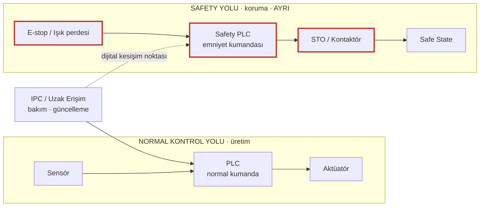

# LAB 1 · Safety Architecture — Genel Sürüm, Venom 3X için

| Ad Soyad | Grup | Tarih |
|---|---|---|
| Yunus Emeç | 1.Şube / Gece-B |   |

**Çıktı:** Safety Function Map → Evidence Pack **EP 03 Safety Functions**

**Makine:** Elfamak Venom 3X CNC router · Bilgilerin kaynağı: [00-makine-kimlik-karti.md](../00-makine-kimlik-karti.md)

**Şablon:** Safety 4.0 Bootcamp laboratuvar föyü, Genel Sürüm (Şişeleme Hattı). Sorular şablondaki gibidir; cevaplar Venom 3X içindir.

> **Kavram (föyden):** Emniyet fonksiyonu, insanı koruyan fonksiyondur ve ayrı bir safety yolunda yaşar (E-stop → Safety PLC → STO). Gerekli güvenilirliği (PLr/SIL) riskle orantılıdır — ve bu güvenilirlik, dijital bir konfigürasyona bağlıdır.

## Şema (şablon) — Soru 3 işaretli

Kırmızı çerçeveli kutular **safety-related control system**'dir (Soru 3).

| Şablondaki öğe | Venom 3X karşılığı |
|---|---|
| Sensör | Konveyör sensörleri, takım boyu ölçümü |
| PLC | Beckhoff kontrol ünitesi (**Varsayım:** PC tabanlı) |
| Aktüatör | Servo eksenler, 11 kW spindle, yükleme sistemi, konveyör, vakum |
| IPC / Uzak erişim | Kontrol paneli PC'si, USB/program aktarımı, kablosuz el çarkı, uzak servis (**Varsayım**) |
| E-stop / Işık perdesi | Panelde ve kablosuz el çarkında acil durdurma görünümlü buton (görsel); erişim algılama için kamuya açık kanıt yok |
| Safety PLC | Bilinmiyor (Safety PLC mi, emniyet rölesi mi?) |
| STO / Kontaktör | Bilinmiyor |
| Safe State | Bkz. Soru 6 |

## Görev — sırayla cevaplar

**1. Bu makinede tehlike nedir? İnsan neyden zarar görür?**

Dönen 11 kW spindle ve kesici takım (kesilme, kopma; kırılan takımın veya parçanın fırlaması), hareketli köprü ve servo eksenler (ezilme, çarpma), makaslı otomatik yükleme platformu (plaka yerleştirilirken ezilme), operatör parça aldıkça kendiliğinden ilerleyen boşaltma konveyörü (el sıkışması) ve takım değişimi (spindle yakınında çalışma). Vakum kaybında parça tutuşunu kaybedip fırlayabilir.

**2. Safety function (emniyet fonksiyonu) hangisidir?**
- **SF-01 Acil durdurma:** butona basılınca tüm hareket ve spindle durur. Hem panelde hem kablosuz el çarkında buton görünüyor; devre yapısı bilinmiyor.
- **SF-02 Tehlike bölgesine erişimde durdurma:** köprü çalışma alanı ile yükleme/boşaltma bölgesi. Risk bunu gerektiriyor; kamuya açık kanıt yok.
- **SF-03 Manuel modda güvenli hareket:** el çarkıyla ayar yaparken sınırlı hız; bağlantı koparsa durma. Gerekli; kamuya açık kanıt yok.
- **SF-04 Vakum tutuşu kaybında durdurma:** vakum bölgeleri yazılımla açılıp kapandığı için, parça tutuşunu kaybederse makine durmalı. Gerekli; kamuya açık kanıt yok.

**Tabla Koruma Sistemi emniyet fonksiyonu değildir:** Kataloğun kendi ifadesiyle tablayı, takımı ve spindle'ı korur, insanı değil. Normal kontrol yazılımında çalışır. Makine koruma fonksiyonudur.

**3. Safety-related control system nerede? Şemada işaretleyin.**

Şemada kırmızı çerçeveyle işaretlendi: acil stop / erişim algılama → emniyet mantığı → STO / kontaktör. Venom'da bu zincirin Beckhoff kontrol sisteminden ayrı bir Safety PLC veya emniyet rölesiyle mi, yoksa aynı kontrol sistemi içindeki bir emniyet modülüyle mi kurulduğu kamuya açık bilgide yok.

**4. Normal PLC ile Safety PLC farkı nedir?**

Normal PLC üretimi yürütür (takım yolu, hız, yükleme sırası); hatası üretimi bozar. Safety PLC sertifikalı ve kendini denetleyen bir kontrolördür; tek görevi tehlike anında makineyi güvenli duruma geçirmektir ve arızada güvenli tarafa düşecek şekilde tasarlanır. Venom'daki Tabla Koruma bu farkın örneğidir: normal kontrolde çalıştığı için bir emniyet fonksiyonunun güvenilirlik garantisini veremez.

**5. PLr / SIL neden var? Bu fonksiyon için neden önemli?**

Koruma riskle orantılı olmalı. Venom'da yaralanma ağır (spindle, köprü), maruziyet sık (her plakada operatör makinenin önünde), kaçınma zor (yüksek hız). Üç soru da yüksek tarafa düştüğü için gereken performans yüksek uçta olur. Bu bir ISO 13849 hesabı değil, mantık yürütmedir. Venom için beyan edilmiş PLr/SIL yok; AT beyanı ISO 13849 / IEC 62061'e atıf yapmıyor.

**6. Safe state (güvenli durum) nedir?**

Spindle, eksenler, yükleme sistemi ve konveyör durmuş; tahrik enerjisi kesilmiş. Ağır spindle önce kontrollü frenlenip sonra enerjisi kesilmeli (durdurma kategorisi 1 mantığı). Vakum ise takım tamamen durana kadar parçayı tutmaya devam etmeli; vakumu da kesen bir durdurma, parçayı serbest bırakıp fırlatabilir. (**Varsayım/gerekçe:** vakumun durdurmadaki davranışı kamuya açık değil.)

**7. Safety function hangi dijital bağımlılıklara sahip?**

Emniyet devresi programlanabilir bir modülle kuruluysa onun programı ve parametreleri; servo sürücülerin STO ve durdurma parametreleri; emniyet sinyalleri Beckhoff haberleşme hattından taşınıyorsa o hattın konfigürasyonu; manuel mod hız sınırı ve el çarkı bağlantısı; özellikle **el çarkındaki acil stop'un kablosuz bağlantısı** (bağlantı koparsa makine durmalı). Vakum bölgelerinin yazılımla yönetilmesi (SF-04). Dolaylı olarak takım boyu verisi ve tabla koruma eşiği.

**8. Siber müdahale hangi noktadan bu fonksiyonu bozar?**

Dijital kesişim noktası kontrol paneli PC'sidir: program, parametre ve (aynı sistemdeyse) emniyet konfigürasyonu buradan değiştirilebilir. Bu noktaya USB/program aktarımı, ağ, uzak servis (varsa) ve kablosuz el çarkı üzerinden ulaşılır. Ayrıntılı envanter LAB 2'de.

---

*Bu föyün çıktısı Safety Function Map → Evidence Pack EP 03 Safety Functions başlığına oturur. Ayrıntılı harita: [lab1-paketpro-surumu.md](lab1-paketpro-surumu.md).*

*Bu bir eğitim çıktısıdır, resmî denetim değildir.*
