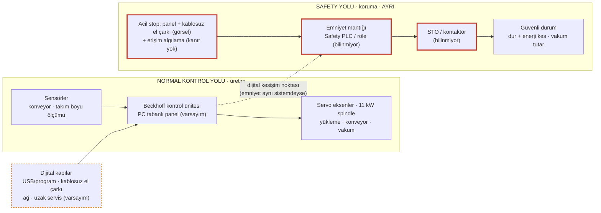

# LAB 1 · Safety Architecture — PaketPro Sürümü (Venom 3X'e uyarlanmış)

| Ad Soyad | Grup | Tarih |
|---|---|---|
| Yunus Emeç | 1.Şube / Gece-B |   |

**Çıktı:** Safety Function Map → Evidence Pack **EP 03 Safety Functions**

**Şablon:** Safety 4.0 Bootcamp laboratuvar föyü, PaketPro 3000 Sürümü. PaketPro'nun yaptığı gibi föy Venom 3X'e uyarlanmıştır: bağlam kutusu ve şema Venom'a göre yazıldı, sorular aynıdır.

**Kaynaklar:** [K…] etiketleri [00-makine-kimlik-karti.md](../00-makine-kimlik-karti.md) içindeki kaynak listesine aittir.

> **Venom 3X bağlamı:** Dönen 11 kW spindle ve kesici takım, hareketli köprü, otomatik yükleme sistemi ve operatör parça aldıkça ilerleyen boşaltma konveyörü el/kol için ciddi tehlikedir [K1], [K13]. Görünür koruma, kontrol panelindeki ve **kablosuz el çarkındaki** acil durdurma butonlarıdır [K13 s.7, s.10]; erişim algılama ve emniyet devresinin yapısı kamuya açık değildir. Makinenin PC tabanlı görünen bir kontrol paneli, program aktarımı ve kablosuz el çarkı vardır [K1], [K9], [K13] — sorular oraya gidecek.

## Şema — Venom 3X (Soru 3 işaretli)

Kırmızı çerçeve: **safety-related control system**. Turuncu kesikli çerçeve: dijital kapılar.

## Görev — sırayla cevaplar

**1. Bu makinede tehlike nedir? İnsan neyden zarar görür?**

| Tehlike kaynağı | ISO 12100 türü | Kim, ne zaman | Kaynak |
|---|---|---|---|
| Dönen spindle ve kesici takım (11 kW, HSK F63) | Kesme/kopma; fırlayan takım veya parça | Operatör, tabla başında veya manuel takım değişiminde | [K13 s.6–7] |
| Köprü ve servo eksenler | Ezilme, çarpma | Operatör/bakımcı çalışma alanındayken | [K1], [K13 s.6] |
| Otomatik yükleme sistemi (makaslı kaldırma platformu, 1600 kg) | Ezilme, sıkışma (özellikle makas mekanizması) | Plaka yerleştirilirken yükleme tarafında | [K1], [K13 s.9, s.11] |
| Sensörlü boşaltma konveyörü | Sıkışma, el kaptırma | Operatör parça alırken (konveyör tam bu anda ilerliyor) | [K1] |
| Takım magazini / takım değişimi | Ezilme, kesilme | Manuel takım değişiminde | [K13 s.6] |
| Vakum kaybı | Parça fırlaması | İşleme sırasında yakındaki herkes | [K1] |

Bu makinenin farkı şudur: otomatik yükleme ve boşaltma, operatörü her plakada makinenin hareketli kısımlarının yanına getirir. Tehlike yalnızca takımda değil, insan-makine temas noktalarındadır.

**2. Safety function (emniyet fonksiyonu) hangisidir?**

Bkz. aşağıdaki Safety Function Map. Kısaca: **SF-01 Acil durdurma**, **SF-02 Tehlike bölgesine erişimde durdurma**, **SF-03 Manuel modda güvenli hareket**, **SF-04 Vakum tutuşu kaybında durdurma**.

SF-04 neden var? Ürün sayfasına göre vakum bölgeleri yazılımla, aktüatörle açılıp kapanıyor; ikinci pompa spindle'ın bulunduğu bölgeyi otomatik açıyor [K1]. Parça tutuşunu işleme sırasında kaybederse fırlar. Bunu yakalayıp makineyi durduran bir fonksiyon insanı korur; varlığı kamuya açık değil.

**Tabla Koruma emniyet fonksiyonu değildir.** Katalog, bu sistemin tablayı, takımı ve spindle motorunu koruduğunu söylüyor [K2], [K13 s.7]; insanı koruduğunu söylemiyor. Normal kontrol yazılımında çalışıyor ve "program hatalı olsa bile" diye tanıtılıyor: yani üretim hatasına karşı bir makine koruma fonksiyonu. **Ama emniyete dokunan bir yanı var:** devre dışı kalırsa veya eşiği değişirse takım tablaya veya parçaya çarpar; kırılan takım fırlayabilir. Bu yüzden LAB 2–3'te "emniyete dokunan veri" olarak izlenir (MF-01).

**3. Safety-related control system nerede? Şemada işaretleyin.**

Şemada kırmızı çerçeveyle işaretlendi: acil stop / erişim algılama → emniyet mantığı → STO / kontaktör. Kritik bilinmeyen, bu zincirin **nerede yaşadığı**:
- **(a)** Kablolu bir emniyet rölesi veya ayrı bir Safety PLC ise, Beckhoff kontrol ünitesinden fiziksel olarak bağımsızdır.
- **(b)** Aynı kontrol sistemine bağlı programlanabilir bir emniyet modülü ise, emniyet mantığı ile normal kontrol aynı haberleşme hattını ve mühendislik aracını paylaşır.

Katalogdaki "yüksek güvenlikli haberleşme protokolü" ifadesi [K1], [K13 s.7] (b)'yi düşündürebilir ama "güvenlik" sözcüğünün emniyet mi güvenlik mi olduğu belirsiz. Bu bilinmeyen, LAB 2'deki zone kararını belirler.

**4. Normal PLC ile Safety PLC farkı nedir?**

Normal kontrol (Venom'da Beckhoff kontrol ünitesi) üretimi yürütür: takım yolu, hız, takım değişimi, yükleme sırası. Hatası tolere edilir; sonuç ıskarta parçadır. Safety PLC sertifikalı, çift kanallı ve kendini sürekli test eden bir kontrolördür. Tek görevi tehlike anında güvenli duruma geçmektir; kendi arızasında bile güvenli tarafa düşecek şekilde tasarlanır.

Yazılım karşılığı: normal PLC iş mantığıdır; Safety PLC ise ayrı süreçte koşan, kendini doğrulayan ve iş mantığı çökse bile sistemi durdurabilen bir devre kesicidir (circuit breaker). Tabla Koruma'nın normal kontrolde olması bu yüzden önemlidir: ne kadar akıllı olursa olsun, devre kesicinin değil iş mantığının parçasıdır.

**5. PLr / SIL neden var? Bu fonksiyon için neden önemli?**

Koruma keyfî değil, riskle orantılıdır. Risk grafiğinin üç sorusunu SF-02 (erişimde durdurma) için cevaplayınca:

| Soru | Venom 3X | Gerekçe |
|---|---|---|
| Yaralanma ne kadar ağır? (S) | Ağır, geri dönüşsüz | 11 kW spindle, ağır köprü [K13] |
| İnsan tehlikeye ne sıklıkta yaklaşır? (F) | Sık | Otomatik yükleme/boşaltmada her plakada [K1] |
| Tehlikeden kaçmak mümkün mü? (P) | Zor | Yüksek devir ve hız |

Üçü de yüksek tarafa düştüğü için gereken performans yüksek uçta olmalıdır (PL d–e aralığı). Bu bir ISO 13849 hesabı değil, mantık yürütmedir. Venom için beyan edilmiş bir PLr/SIL kamuya açık değil; AT beyanı ISO 13849 / IEC 62061'e atıf yapmıyor [K3]. Önemi şu: bu performans emniyet konfigürasyonuna bağlıdır. Konfigürasyon değişirse, kâğıttaki PL artık gerçeği anlatmaz.

**6. Safe state (güvenli durum) nedir?**
- Spindle, eksenler, yükleme sistemi ve konveyör durmuş; tahrik enerjisi kesilmiş.
- Büyük kütleli spindle önce kontrollü frenlenmeli, sonra enerjisi kesilmeli (EN 60204-1 durdurma kategorisi 1 mantığı; AT beyanı bu standarda atıf yapıyor [K3]).
- **Bağlama özel nokta:** vakum, takım tamamen durana kadar parçayı tutmaya devam etmeli. "Her şeyi kapat" diyen bir durdurma vakumu da keserse, yavaşlayan takımın yanındaki parça serbest kalıp fırlayabilir. Sözlükteki "boya kabininde egzoz çalışmaya devam etsin" örneğinin bu makinedeki karşılığı budur.
- **Varsayım/gerekçe:** vakumun durdurmadaki davranışı kamuya açık değil.

**7. Safety function hangi dijital bağımlılıklara sahip?**

| Bağımlılık | Hangi SF | Neden dijital | Kaynak / durum |
|---|---|---|---|
| Emniyet mantığının programı ve parametreleri | SF-01, SF-02 | Programlanabilir modül ise mühendislik aracıyla değişir | Bilinmiyor |
| Servo sürücülerin STO ve durdurma parametreleri | SF-01, SF-02 | Sürücü konfigürasyonu ve firmware | Beckhoff sürücüler [K1]; parametreler bilinmiyor |
| "Yüksek güvenlikli haberleşme protokolü" | SF-01, SF-02 | Emniyet sinyali bu hattan taşınıyorsa hattın konfigürasyonu | [K1], belirsiz |
| Manuel mod hız sınırı, el çarkı bağlantı davranışı | SF-03 | Yazılım parametresi + kablosuz bağlantı | [K1]; ayrıntı yok |
| **El çarkındaki acil stop'un kablosuz bağlantısı** | SF-01 | Emniyet sinyali radyo üzerinden taşınıyor; bağlantı koparsa makinenin durması (fail-safe) bu bağlantının tasarımına bağlı | [K13 s.10]; protokol bilinmiyor |
| Vakum bölgelerinin yazılımla, aktüatörle açılıp kapanması | SF-04 | Hangi bölgenin tuttuğuna kontrol yazılımı karar veriyor; vakum izleme de aynı yazılımdaysa bir parametreyle devre dışı kalabilir | [K1], [K13 s.8] |
| Takım boyu hafızası, tabla koruma eşiği (1 mm) | MF-01 (dolaylı emniyet) | Kontrol yazılımındaki veri | [K2], [K13 s.6] |

**8. Siber müdahale hangi noktadan bu fonksiyonu bozar?**

**Dijital kesişim noktası kontrol paneli PC'sidir.** Program, parametre ve (emniyet mantığı aynı sistemdeyse) emniyet konfigürasyonu tek bir noktadan erişilebilir. Bu noktaya giden kapılar:
- USB / program aktarımı [K9]
- kablosuz el çarkı — hem hareket komutu hem acil stop sinyali taşıyor [K1], [K13 s.10]
- ağ bağlantısı (**Varsayım**)
- uzak servis (**Varsayım**)

Bozulma biçimleri:
- **(a)** Emniyet konfigürasyonu değişir → SF-01/SF-02 gecikir ya da devre dışı kalır.
- **(b)** Manuel mod hız sınırı veya el çarkı davranışı değişir → SF-03 bozulur.
- **(c)** Takım boyu veya tabla koruma verisi değişir → çarpma ve fırlama.
- **(d)** Vakum bölge seçimi değişir → parça tutuşunu kaybeder → SF-04 bozulur.

Kapılar LAB 2 envanterinde kodlanır, senaryolar LAB 3'te yazılır.

---

## Çıktı — Safety Function Map (EP 03)

| ID | Fonksiyon | Tetikleyici | Emniyet mantığı | Çıkış | Güvenli durum | Korunan tehlike | Kamuya açık kanıt (beyan < prosedür < kayıt < doğrulanmış kayıt) | Dijital bağımlılık |
|---|---|---|---|---|---|---|---|---|
| **SF-01** | Acil durdurma | Paneldeki ve kablosuz el çarkındaki acil stop butonları | Bilinmiyor (röle / Safety PLC) | STO / kontaktör (**Varsayım**) | Kontrollü dur → enerji kes; vakum tutar | Tümü | **Beyan altı:** yalnızca katalog fotoğrafları [K13 s.7, s.10] | Emniyet parametreleri, STO ayarı, el çarkının radyo bağlantısı |
| **SF-02** | Tehlike bölgesine erişimde durdurma | Erişim algılama (tür bilinmiyor) | Bilinmiyor | Bilinmiyor | Aynı | Köprü, yükleme, boşaltma | **Yok** | Emniyet parametreleri, muting/bypass ayarı |
| **SF-03** | Manuel modda güvenli hareket | Manuel mod / kablosuz el çarkı | Bilinmiyor | Hız sınırlama, bağlantı kopunca dur | Eksen durur | Ayar sırasında ezilme, çarpma | **Yok** | Hız sınırı parametresi, kablosuz bağlantı |
| **SF-04** | Vakum tutuşu kaybında durdurma | Vakum düşüşü (izleme türü bilinmiyor) | Bilinmiyor | Spindle ve eksenler durur | Dur; vakum tutmaya devam | Fırlayan parça/takım | **Yok** (vakum bölge kontrolü belgeli [K1], izleme belgeli değil) | Vakum bölge seçimi, izleme parametresi |
| MF-01 | Tabla Koruma *(makine koruma, emniyet fonksiyonu değil)* | Z ekseni tablaya 1 mm | Normal kontrol yazılımı | Spindle durur | — | Tabla, takım, spindle (dolaylı: fırlama) | **Beyan:** katalog/ürün sayfası [K2], [K13 s.7] | Eşik değeri, takım boyu verisi |

**EP 03 durumu: Taslak.** Fonksiyonlar adlandırıldı, kanıtları yok veya beyan düzeyinde.

---

*Bu föyün çıktısı Safety Function Map → Evidence Pack EP 03 Safety Functions başlığına oturur.*

*Bu bir eğitim çıktısıdır, resmî denetim değildir.*
