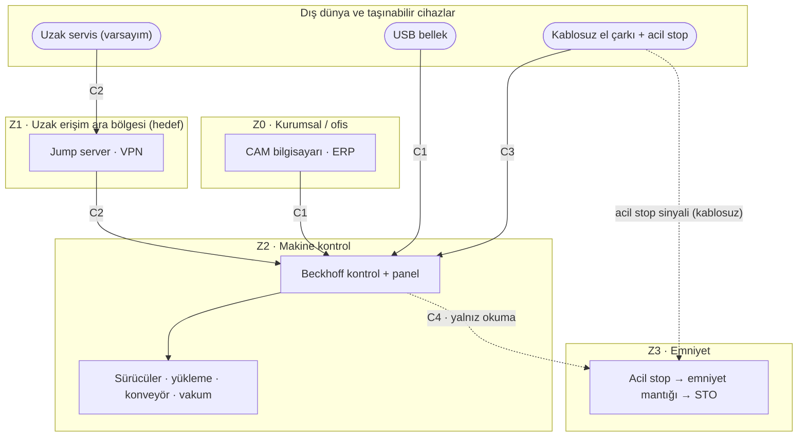

# LAB 2 · IEC 62443 Mini Workshop — Genel Sürüm, Venom 3X için

| Ad Soyad | Grup | Tarih |
|---|---|---|
| Yunus Emeç | 1.Şube / Gece-B |   |

**Çıktı:** Envanter + Zone / Conduit Diagram → Evidence Pack **EP 05 Zone & Conduit**

**Şablon:** Safety 4.0 Bootcamp laboratuvar föyü, Genel Sürüm (Şişeleme Hattı). Sorular ve varlık listesi şablondaki gibidir; cevaplar Venom 3X içindir.

**Kaynaklar:** [00-makine-kimlik-karti.md](../00-makine-kimlik-karti.md). Varlık (V-), kapı (K-) ve bölge (Z) kodları [lab2-paketpro-surumu.md](lab2-paketpro-surumu.md) ile aynıdır.

> **Kavram (föyden):** Zone = benzer kritiklikteki cihazları bir bölgeye topla. Conduit = bölgeler arası her geçişe kontrollü bir kapı. 62443'ün maddesini ezberlemiyoruz — mantığını uyguluyoruz.

## Görev A0 — Envanter (altı kategori)

| Kategori | Venom 3X'te bulunanlar |
|---|---|
| Donanım | Beckhoff kontrol ünitesi, panel (ekran + acil stop), servo ve spindle sürücüleri, takım magazini ve takım boyu ölçümü, yükleme sistemi, sensörlü konveyör, vakum, kablosuz el çarkı (üzerinde acil stop), yağlama ünitesi; emniyet devresi ve makine ağı (**Varsayım**) |
| Yazılım / firmware | CNC/HMI yazılımı, işletim sistemi (**Varsayım**), Tabla Koruma yazılımı, sürücü firmware'i, CAM yazılımı (işletme tarafı) |
| Hesaplar | Operatör (**Varsayım:** paylaşılan), parametre/mühendislik yetkisi, servis/tedarikçi hesabı — hepsi kamuya açık bilgide yok |
| Sertifika / anahtar | El çarkı eşleştirme bilgisi, uzak erişim kimlik bilgileri — bilinmiyor |
| Dış bağlantı | Kablosuz el çarkı (belgeli); USB/program aktarımı, fabrika ağı, uzak servis (**Varsayım**) |
| Kritik veri akışı | CAD/CAM → program; takım boyu → takım tablosu; tabla koruma eşiği; sensör → konveyör; acil stop → emniyet mantığı → STO |

Ayrıntılı 32 satırlık envanter ve **kapı listesi (K-01…K-06)** PaketPro sürümündedir.

## Görev A — varlıkları bölgelere ayırın

**Varlık listesi (şablon):** PLC · HMI · Robot kontrolörü · Safety PLC · SCADA istemcisi · Mühendislik istasyonu · Uzak servis erişimi · Ofis ağı (ERP/e-posta)

| Şablondaki varlık | Venom 3X karşılığı | Durum |
|---|---|---|
| PLC | Beckhoff kontrol ünitesi (V-01) | Belgeli [K1] |
| HMI | Kontrol paneli ekranı (V-02) | Katalog fotoğrafı [K13 s.7] |
| Robot kontrolörü | Robot yok; en yakın karşılık otomatik yükleme sistemi (V-07) | Belgeli [K1] |
| Safety PLC | Emniyet devresi (V-12) | Bilinmiyor |
| SCADA istemcisi | Kamuya açık bilgide yok; "tam otomatik üretim hattı" hat düzeyinde izleme ihtimalini düşündürüyor | **Varsayım** [K1] |
| Mühendislik istasyonu | CAM bilgisayarı (V-18) ve servis dizüstü bilgisayarı | **Varsayım** |
| Uzak servis erişimi | V-27 | **Varsayım** |
| Ofis ağı (ERP/e-posta) | İşletmenin kurumsal ağı (V-26 üzerinden) | **Varsayım** |

**1. Hangi varlıklar aynı bölgede? Bölgeleri adlandırıp gruplandırın.**
- **Z0 Kurumsal / ofis:** ERP, e-posta, CAM bilgisayarı
- **Z1 Uzak erişim ara bölgesi** (hedef): jump server, VPN bitiş noktası
- **Z2 Makine kontrol:** Beckhoff kontrol ünitesi ve paneli, servo ve spindle sürücüleri, yükleme, konveyör, vakum, sensörler
- **Z3 Emniyet:** acil stop zinciri, emniyet mantığı (Safety PLC / röle), STO girişleri

**2. Safety PLC'yi hangi bölgeye koydunuz — neden?**

**Z3'e, ayrı ve en yüksek korumalı bölgeye.** Çünkü insanı koruyan tek katman odur. Zone mantığında bölge içi güvenilir kabul edildiği için, Safety PLC normal kontrolle aynı bölgede olursa Z2'yi ele geçiren emniyeti de ele geçirir. Venom'da emniyet mantığının ayrı bir cihaz mı yoksa aynı kontrol sistemindeki bir modül mü olduğu bilinmiyor. İkinci durumda ayrım yalnızca mantıksaldır: emniyet konfigürasyonuna yalnızca ayrı yetkiyle ve makine başından erişilmeli, kontrol ünitesi emniyetin yalnızca durumunu okuyabilmelidir. Kablosuz el çarkındaki acil stop da Z3'e aittir.

**3. Bölgeler arası geçişler (conduit) nerede? Her geçişte ne kontrol edilecek?**
- **C1 · Z0 → Z2, program aktarımı:** tek yön, yalnızca program dosyası, yükleme kaydı, kayıtlı USB.
- **C2 · Dış → Z1 → Z2, uzak servis:** en riskli geçiş; Görev B'deki altı karar.
- **C3 · El çarkı → Z2, kablosuz:** eşleştirme, bağlantı kopunca dur, onay butonu, hız sınırı; el çarkındaki acil stop'un sinyali kaybolursa güvenli dur.
- **C4 · Z2 → Z3:** yalnızca durum okuma; emniyet parametresi değişikliği ayrı yetki, kayıt ve doğrulama ister.

## Görev B — uzak erişim kararı (6 satır)

| Karar | Seçenekler | Seçim | Neden |
|---|---|---|---|
| Aracı? | Doğrudan / Jump server | **Jump server** | Panel PC'si doğrudan açılırsa program, parametre ve belki emniyet konfigürasyonu tek adımda erişilebilir olur. |
| Tünel? | Açık / VPN | **VPN** | Takım yolları ve parametreler fabrika dışında dinlenmemeli, değiştirilmemeli. |
| Kimlik? | Parola / MFA | **MFA** | Küçük bir servis ekibinin parolası sızarsa birçok müşteri makinesi açılır. |
| Hesap? | Paylaşılan / Kişisel | **Kişisel** | Parametreyi kimin değiştirdiğini ancak kişisel hesap gösterir. |
| Kayıt? | Yok / Tam oturum kaydı | **Tam oturum kaydı** | Kaza veya olay sonrası neyin değiştiğinin kanıtı. |
| Zamanlama? | Sürekli açık / Varsayılan kapalı | **Varsayılan kapalı** | Servis seyrek gerekir; açma onayı makine başındaki operatörde olmalı. |

---

*Bu föyün çıktısı Zone / Conduit Diagram → Evidence Pack EP 05 Zone & Conduit başlığına oturur.*

*Bu bir eğitim çıktısıdır, resmî denetim değildir.*
