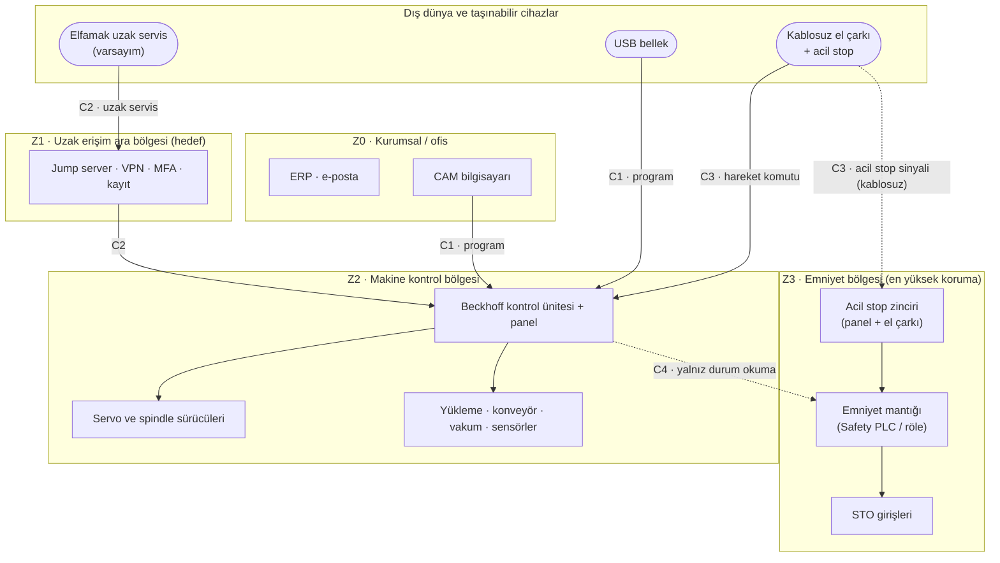

# LAB 2 · IEC 62443 Mini Workshop — PaketPro Sürümü (Venom 3X'e uyarlanmış)

| Ad Soyad | Grup | Tarih |
|---|---|---|
| Yunus Emeç | 1.Şube / Gece-B |   |

**Çıktı:** Envanter + Zone / Conduit Diagram → Evidence Pack **EP 05 Zone & Conduit**

**Şablon:** Safety 4.0 Bootcamp laboratuvar föyü, PaketPro 3000 Sürümü. PaketPro'da olduğu gibi varlık listesi makineye özel yazıldı; PaketPro'ya özgü 2. soru Venom'a çevrildi.

**Kaynaklar:** [K…] etiketleri [00-makine-kimlik-karti.md](../00-makine-kimlik-karti.md) içindeki kaynak listesine aittir. **V-** varlık, **K-** kapı, **Z** bölge, **C** geçiş (conduit) kodudur.

> **Kavram (föyden):** Zone = benzer kritiklikteki cihazları bir bölgeye topla. Conduit = bölgeler arası her geçişe kontrollü bir kapı. 62443'ün maddesini ezberlemiyoruz — mantığını uyguluyoruz.

## Görev A0 — Envanter (altı kategori, her kategoride üç kez "başka?")

| ID | Kategori | Varlık | Kanıt / not | Kaynak |
|---|---|---|---|---|
| V-01 | Donanım | Beckhoff kontrol ünitesi | **Varsayım:** PC tabanlı | [K1], [K11] |
| V-02 | Donanım | Kontrol paneli: ekran + buton paneli + acil stop butonu | Katalog fotoğrafı | [K13 s.7] |
| V-03 | Donanım | Servo sürücüler (Beckhoff) | STO özelliği bilinmiyor | [K1] |
| V-04 | Donanım | Servo motorlar, tüm eksenlerde | — | [K1] |
| V-05 | Donanım | Spindle (11 kW, HSK F63) ve sürücüsü | Sürücü bilinmiyor | [K13 s.7] |
| V-06 | Donanım | 15 takımlı magazin + takım boyu ölçüm düzeneği | — | [K13 s.6] |
| V-07 | Donanım | Otomatik yükleme sistemi | — | [K1] |
| V-08 | Donanım | Sensörlü boşaltma konveyörü + süpürme | — | [K1] |
| V-09 | Donanım | Vakum pompaları + bölge aktüatörleri + bölge seçim paneli | Döner seçicilerle | [K1], [K13 s.8] |
| V-10 | Donanım | Kablosuz el çarkı (Elfatek) | Üzerinde acil durdurma görünümlü buton; bağlantı türü ve onay butonu bilinmiyor | [K1], [K13 s.10] |
| V-11 | Donanım | Merkezi yağlama ünitesi | Zaman ayarlı | [K13 s.6] |
| V-12 | Donanım | Emniyet devresi (röle veya Safety PLC; STO girişleri) | **Varsayım** — yapı bilinmiyor | [K3] (EN 60204-1) |
| V-13 | Donanım | Makine ağı / ağ anahtarı | **Varsayım** | — |
| V-14 | Yazılım | CNC / HMI kontrol yazılımı | Ad, sürüm bilinmiyor; kontrol Beckhoff veya Siemens seçenekli (analiz Beckhoff'u esas alır); ekranda pencereli masaüstü yazılımı | [K13 s.7, s.12] |
| V-15 | Yazılım | İşletim sistemi | **Varsayım:** masaüstü işletim sistemi | [K13 s.7] |
| V-16 | Yazılım | Tabla Koruma yazılımı (Elfamak) | — | [K2] |
| V-17 | Yazılım / firmware | Sürücü firmware'i; emniyet modülü programı (varsa) | **Varsayım** | — |
| V-18 | Yazılım | CAM / nesting yazılımı | Katalog CAM ve nesting çözümü sunuyor; sitenin anahtar kelimelerinde "alphacam" geçiyor, doğrulanmadı | [K4], [K9], [K13 s.10] |
| V-19 | Hesap | Operatör hesabı (panel) | **Varsayım:** vardiyalar arasında paylaşılan | — |
| V-20 | Hesap | Parametre / mühendislik yetkisi (takım tablosu, tabla koruma eşiği, hız sınırı) | Bilinmiyor | — |
| V-21 | Hesap | Servis / tedarikçi hesabı (Elfamak servisi) | Bilinmiyor | — |
| V-22 | Sertifika / anahtar | El çarkı eşleştirme bilgisi | Bilinmiyor | — |
| V-23 | Sertifika / anahtar | Uzak erişim kimlik bilgileri, VPN anahtarı (varsa) | Bilinmiyor | — |
| V-24 | Dış bağlantı | Kablosuz el çarkı bağlantısı | Belgeli; türü bilinmiyor | [K1] |
| V-25 | Dış bağlantı | Program aktarımı (USB veya ağ) | **Varsayım:** yöntem bilinmiyor | [K9] |
| V-26 | Dış bağlantı | Fabrika / ofis ağı bağlantısı | **Varsayım:** "tam otomatik üretim hattı" konumlandırması | [K1], [K10] |
| V-27 | Dış bağlantı | Uzak servis bağlantısı | **Varsayım:** firmanın WhatsApp destek hattı insan desteği; makineye uzaktan erişim doğrulanmadı | [K4] |
| V-28 | Veri akışı | CAD/CAM → takım yolu programı → kontrol | — | [K9] |
| V-29 | Veri akışı | Takım boyu ölçümü → takım tablosu → Z hareketi | Emniyete dokunan veri (çarpma/fırlama) | [K13 s.6] |
| V-30 | Veri akışı | Tabla koruma eşiği (1 mm) | Emniyete dokunan veri | [K2] |
| V-31 | Veri akışı | Konveyör sensör sinyali → konveyör hareketi; vakum bölge seçimi | Vakum bölge seçimi SF-04'e dokunan veri | [K1], [K13 s.8] |
| V-32 | Veri akışı | Emniyet sinyalleri: acil stop (panel + **kablosuz el çarkı**) → emniyet mantığı → STO | El çarkındaki acil stop sinyali kablosuz; "yüksek güvenlikli haberleşme" ifadesi belirsiz | [K1], [K13 s.10] |

**Sonuç:** "Bir CNC router" diye başlayan makinede sistematik sayımla **32 varlık** ve **4 dış bağlantı** (V-24…V-27) çıktı. Bunların 13'ünün varlığı bile kamuya açık bilgiyle doğrulanamıyor (V-12, V-13, V-15, V-17–V-23, V-25–V-27): bu, kamuya açık kanıtın zayıflığını gösteren bir bulgudur.

### Kapı listesi (LAB 3'e girdi)

| Kapı | Dayandığı varlıklar | Neden kapı |
|---|---|---|
| **K-01** USB / program aktarımı | V-25, V-28 | Makineye dışarıdan dosya giren yol |
| **K-02** Uzak servis bağlantısı (**Varsayım**) | V-27, V-21, V-23 | Dışarıdan doğrudan kontrol ünitesine erişim |
| **K-03** Kablosuz el çarkı | V-10, V-24, V-22, V-32 | Hem hareket komutu hem acil stop sinyali taşıyan kablosuz cihaz |
| **K-04** Paylaşılan panel hesabı / parametre yetkisi | V-19, V-20 | Kim olduğu bilinmeden parametre değişimi |
| **K-05** Fabrika / ofis ağı bağlantısı (**Varsayım**) | V-26, V-13 | IT ağından makineye yol |
| **K-06** Emniyet konfigürasyonuna mühendislik erişimi | V-12, V-17, V-32 | Emniyete doğrudan dokunan kapı |

## Görev A — varlıkları bölgelere ayırın

> **Venom 3X varlık listesi (PaketPro'daki gibi):** Beckhoff kontrol ünitesi (PC tabanlı görünüyor) · panel (ekran + acil stop) · servo ve spindle sürücüleri · **kablosuz el çarkı** (üzerinde acil stop; bağlantı türü belirsiz) · USB / program aktarımı (yöntem belirsiz) · takım boyu hafızası ve tabla koruma eşiği (emniyete dokunan veri) · otomatik yükleme + sensörlü konveyör · emniyet devresi (yapısı belirsiz) · uzak servis (varsayım)

**1. Hangi varlıklar aynı bölgede? Bölgeleri adlandırıp gruplandırın.**

| Bölge | Varlıklar | Kritiklik |
|---|---|---|
| **Z0 · Kurumsal / ofis** (işletme ağı) | ERP, e-posta, CAM bilgisayarı (V-18) | Düşük — internete açık |
| **Z1 · Uzak erişim ara bölgesi** (*hedef*; bugün olmadığı varsayılıyor) | Jump server, VPN bitiş noktası | Ara — dış dünya ile makine arası tampon |
| **Z2 · Makine kontrol bölgesi** | V-01, V-02 (ekran ve butonlar), V-03–V-09, V-11, V-13, V-14–V-16 | Yüksek — üretimi ve hareketi yönetir |
| **Z3 · Emniyet bölgesi** | V-12, acil stop zinciri, STO girişleri, V-17 (emniyet programı), V-32 | En yüksek — insanı korur |

**2. Kablosuz el çarkı hangi bölgeye düşüyor — ve orada KALABİLİR Mİ? Neden?**

*(PaketPro'daki orijinal soru: "Açık uzak bakım modülü hangi bölgeye düşüyor — ve orada KALABİLİR Mİ?" Venom'da belgelenmiş tek kablosuz kapı el çarkı olduğu için soru ona uyarlandı.)*

El çarkı bugün fiilen **Z2'nin içinde** sayılıyor: doğrudan kontrol ünitesine hareket komutu veriyor [K1]. **Orada güvenilir bir Z2 üyesi olarak kalamaz.** Zone mantığında bölge içi güvenilir kabul edilir; oysa kablosuz bir cihazın sınırı fabrika duvarı değil, radyo menzilidir. El çarkı ayrı bir geçişle (**C3**) bağlanmalı. O geçişte şunlar kontrol edilmeli:
- yalnızca eşleştirildiği makineye komut versin,
- bağlantı koparsa hareket dursun,
- hareket yalnızca manuel modda, sınırlı hızda ve onay butonu basılıyken mümkün olsun.

Katalog fotoğrafına göre el çarkının üzerinde bir acil durdurma butonu da var [K13 s.10]. Yani el çarkı iki ayrı şey taşıyor: **hareket komutu (Z2)** ve **emniyet sinyali (Z3)**. Acil stop sinyali bir radyo bağlantısına bağımlı olduğu için ek bir kontrol gerekiyor: bağlantı koparsa veya sinyal doğrulanamazsa makine güvenli duruma geçmeli (fail-safe).

**3. Bölgeler arası geçişler (conduit) nerede? Her geçişte ne kontrol edilecek?**

| Geçiş | Yön | Kontrol edilecek |
|---|---|---|
| **C1** program aktarımı (K-01, K-05) | Z0 → Z2 | Tek yönlü; yalnızca program dosyası girer; tanımlı dosya türü; kim, ne zaman yükledi kaydı; USB için yalnızca kayıtlı bellek ve tarama |
| **C2** uzak servis (K-02) | Dış → Z1 → Z2 | **En riskli geçiş.** Görev B'deki altı karar; Z3'e hiçbir uzak yol yok |
| **C3** kablosuz el çarkı (K-03) | El çarkı → Z2 | Eşleştirme, bağlantı kopunca dur, onay butonu, manuel mod + hız sınırı; **acil stop sinyali kaybolursa güvenli dur** |
| **C4** kontrol → emniyet (K-06) | Z2 → Z3 | Kontrol ünitesi emniyet mantığının yalnızca **durumunu okur**; emniyet parametresini değiştiremez. Emniyet konfigürasyonu ayrı yetki, makine başından erişim, değişiklik kaydı ve değişiklik sonrası emniyet doğrulaması (safety validation) gerektirir |

### Zone / Conduit Diagram (EP 05)

**Kilit soru — Safety PLC ayrı zone mu?** Kamuya açık bilgiyle cevaplanamıyor (bkz. LAB 1 Soru 3). Emniyet mantığı ayrı bir röle veya Safety PLC ise Z3 fiziksel olarak ayrıdır. Aynı kontrol sistemindeki bir emniyet modülü ise Z3 yalnızca **mantıksal** olarak ayrılabilir ve C4'ün kuralları hayati hâle gelir. LAB 3'te bu belirsizlik E puanını etkiler.

## Görev B — uzak erişim kararı (6 satır)

*Karar: Elfamak servisi uzaktan Venom'un kontrol ünitesine erişmek istiyor.*

| Karar | Seçenekler | Seçim | Neden (Venom 3X için) |
|---|---|---|---|
| Aracı? | Doğrudan / Jump server | **Jump server** | Panel PC'si doğrudan açılırsa program, parametre ve belki emniyet konfigürasyonu tek adımda erişilebilir olur. Ara nokta tek bir kontrol noktası yaratır ve erişimi Z1'de tutar. |
| Tünel? | Açık / VPN | **VPN** | Takım yolları ve parametreler fabrika dışına çıkan trafikte dinlenmemeli, değiştirilmemeli. |
| Kimlik? | Parola / MFA | **MFA** | 25–49 çalışanlı bir üreticide servis ekibi küçüktür [K5]. Bir servis parolasının sızması birçok müşterideki makineyi açabilir (**Varsayım:** müşteriler arasında ortak parola). |
| Hesap? | Paylaşılan / Kişisel | **Kişisel** | "Tabla koruma eşiğini veya takım boyunu kim değiştirdi?" sorusunun cevabı yalnızca kişisel hesapla verilebilir. |
| Kayıt? | Yok / Tam oturum kaydı | **Tam oturum kaydı** | Değişiklik sonrası bir kaza olursa neyin değiştiğinin kanıtıdır; CRA olay bildirimi (LAB 6) bu kayda dayanır. |
| Zamanlama? | Sürekli açık / Varsayılan kapalı | **Varsayılan kapalı** | Servis ayda birkaç kez gerekir; geri kalan zamanda açık kapı yalnızca saldırgana hizmet eder. Açma onayı makine başındaki operatörde olmalı. |

Bu altı karar, 62443'ün mantığını uçtan uca uygular: geçişi daralt, kimliği kanıtla, izini bırak, kullanılmadığında kapat.

---

*Bu föyün çıktısı Zone / Conduit Diagram → Evidence Pack EP 05 Zone & Conduit başlığına oturur. EP 05 durumu: **Taslak** (bölgeler tasarlandı; sahada doğrulanmadı).*

*Bu bir eğitim çıktısıdır, resmî denetim değildir.*
