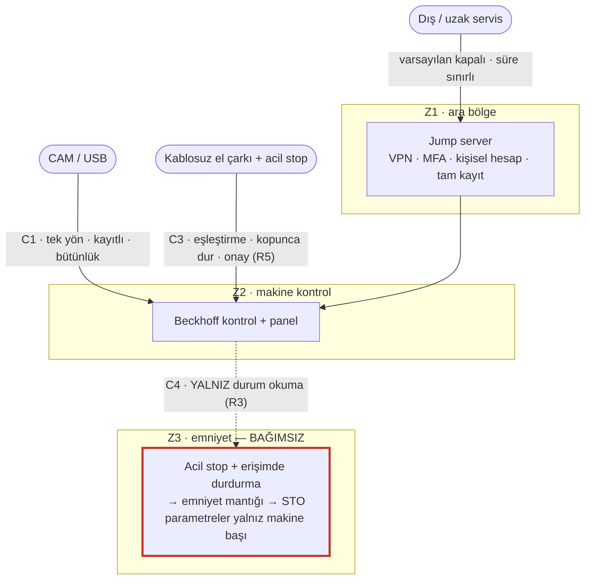

# LAB 4 · Secure Remote Access — PaketPro Sürümü (Venom 3X'e uyarlanmış)

| Ad Soyad | Grup | Tarih |
|---|---|---|
| Yunus Emeç | 1.Şube / Gece-B | 24.10.2026 |

**Çıktı:** Secure Architecture → Evidence Pack **EP 02 + EP 06**
**Şablon:** Safety 4.0 Bootcamp laboratuvar föyü, PaketPro 3000 Sürümü. "Mevcut" ipucu ve functional safety köprüsü sorusu Venom'a uyarlandı.
**Girdi:** LAB 3'ün en yüksek skorlu senaryoları (R-01, R-03: 12) ve S3 senaryosu (R-02). **Kaynaklar:** [00-makine-kimlik-karti.md](../00-makine-kimlik-karti.md).

> **Kavram (föyden):** İki katman, ikisi de şart: **erişim güvenliği** (girişi zorlaştır: ara nokta, VPN, MFA, kişisel hesap, kayıt, varsayılan kapalı) + **emniyet bağımsızlığı** (girse bile insan korunur).
>
> **Tarafsızlık notu (föyden):** Bu föy çözüm tasarlatmaz; **gereksinimi** tanımlatır. Tasarım kararı firmanızındır.

## Görev A — mevcut → hedef

> **İpucu (Venom'a uyarlandı):** Bugün kamuya açık bilgiye göre: uzak servisin varlığı ve yöntemi belirsiz; panel hesabının paylaşımlı olduğu varsayılıyor; kablosuz el çarkı doğrudan kontrol ünitesine komut veriyor; program USB/ağ ile giriyor ve emniyet devresinin yapısı bilinmiyor. "Mevcut"u bu belirsizlikler üzerine, savunmacı dille yazıyoruz.

| MEVCUT (kamuya açık bilgiden çıkan, belirsizliklerle) | HEDEF (beş ilkeyle yeniden tasarlanmış gereksinim) |
|---|---|
| Uzak servis: var mı, nasıl? belirsiz; varsa doğrudan panele ulaşma riski | **1. Ara nokta:** uzak erişim yalnızca jump server üzerinden; panel PC'sine doğrudan dış bağlantı yok |
| Panel hesabı: paylaşılan sayılıyor (kim değiştirdi belirsiz) | **2. Kişisel hesap:** her operatör/servis kişisel hesapla; parametre değişikliği kişiye bağlanabilir |
| Kimlik: parola düzeyi varsayılıyor | **3. İkinci faktör (MFA):** uzak erişimde ve emniyet/parametre yetkisinde |
| Uzak yol sürekli açık olabilir | **4. Varsayılan kapalı, süre sınırlı:** erişim yalnızca ihtiyaç anında, makine başı onayıyla açılır |
| Oturum kaydı belirsiz | **5. Oturum kaydı:** kim, ne zaman, neyi değiştirdi — tam kayıt |
| El çarkı (üzerinde acil stop) ve USB doğrudan kontrol ünitesinde | Program için tek yönlü, kayıtlı, bütünlük kontrollü aktarım (C1); el çarkı için eşleştirme + bağlantı kopunca dur + onay butonu (C3) |

Bu, LAB 2 Görev B'deki altı kararın mimariye dökülmüş hâlidir ve LAB 3'teki R-04'ün (uzak servis fidyesi) L ve E puanlarını düşürür.

## Görev B — functional safety köprüsü

**1. Saldırgan tüm önlemlere rağmen içeri girerse: emniyet fonksiyonu etkilenir mi? Neden?**

**Cevap, emniyet mantığının nerede yaşadığına bağlı — ve kritik bulgu tam bu:**
- Emniyet mantığı Beckhoff kontrol ünitesinden **ayrı** (kablolu emniyet rölesi veya ayrı Safety PLC, kendi STO girişleriyle) ise: saldırgan kontrol PC'sini ele geçirse bile acil durdurma ve erişimde durdurma çalışmaya devam eder. İnsan korunur; saldırgan üretimi bozar ama emniyeti bozamaz.
- Emniyet mantığı kontrol ünitesiyle **aynı sistemde**, aynı haberleşme hattında ve aynı mühendislik aracıyla değişebilen bir modül ise: kontrol PC'sini ele geçiren, emniyet konfigürasyonuna da uzanabilir (LAB 3 R-02). Bu durumda erişim güvenliği tek başına yetmez.

Venom için bu ayrım kamuya açık değil (LAB 1 Soru 3, LAB 2 kilit soru). Katalogdaki "yüksek güvenlikli haberleşme protokolü" ifadesi tek başına emniyet bağımsızlığını kanıtlamaz. **Bu yüzden emniyet bağımsızlığı bir varsayım değil, doğrulanması gereken bir gereksinimdir.**

**2. Acil durdurma / erişimde durdurma zincirinin uzak bakım ve program yolundan etkilenmemesi için GEREKSİNİMİ yazın (çözümü değil).**
*(PaketPro'daki orijinal: "Işık perdesi zincirinin uzak bakım yolundan etkilenmemesi için gereksinimi yazın." Venom'da ışık perdesi belgeli olmadığından, erişimde durdurma + acil durdurma zincirine uyarlandı.)*

> **GEREKSİNİM (çözüm değil):**
> **R1.** Acil durdurma, tehlike bölgesine erişimde durdurma ve vakum tutuşu kaybında durdurma fonksiyonları (SF-01, SF-02, SF-04), normal kontrol sisteminin (Beckhoff kontrol ünitesi, panel PC'si) ele geçirilmesi hâlinde dahi işlevini sürdürebilmelidir; yani bu fonksiyonların yürütülmesi, kontrol PC'sinden gelen hiçbir komuta bağlı olmamalıdır.
> **R2.** Emniyet fonksiyonlarının parametreleri (durdurma tepki süresi, STO ayarı, hız sınırı) hiçbir uzak yoldan ve program/USB aktarımından değiştirilememeli; değişiklik yalnızca makine başında, ayrı yetkiyle ve kayıt altında yapılabilmelidir.
> **R3.** Kontrol sistemi ile emniyet sistemi arasındaki bağ yalnızca **durum okuma** yönünde olmalı (LAB 2 C4); kontrol tarafı emniyet mantığına yazamamalıdır.
> **R4.** Emniyet parametrelerinde her değişiklikten sonra, makine yeniden üretime alınmadan önce bir **emniyet doğrulaması (safety validation)** yapılmalı ve kaydı tutulmalıdır.
> **R5.** Kablosuz el çarkındaki acil durdurma, radyo bağlantısının kesilmesi, bozulması veya sinyalin doğrulanamaması hâlinde makineyi güvenli duruma geçirmelidir (fail-safe); bağlantı kaybı hiçbir koşulda "acil stop basılmadı" olarak yorumlanmamalıdır.

**Tasarım kararı firmanındır.** Bu föy çözümü (hangi marka emniyet PLC, hangi ağ ürünü) seçmez; neyin sağlanması gerektiğini tanımlar. Zafiyet bir saldırı aracına değil, bir gereksinime çevrildi.

## Çıktı — Secure Architecture (EP 02 + EP 06)

**Köprü:** Erişim güvenliği (Z1 + C1 + C3) saldırganı dışarıda tutar; emniyet bağımsızlığı (Z3 + R1–R5) içeri girse bile insanı korur. İkisi de şart — föyün dediği gibi "kemer ve askı".

**EP 02 + EP 06 durumu: Taslak.** Gereksinimler yazıldı; tasarım ve doğrulama firmaya ait.

---

*Bu föyün çıktısı Secure Architecture → Evidence Pack EP 02 + EP 06 başlığına oturur.*
*Tarafsızlık notu: Bu föy çözüm tasarlatmaz; gereksinimi tanımlatır.*
*Bu bir eğitim çıktısıdır, resmî denetim değildir.*
