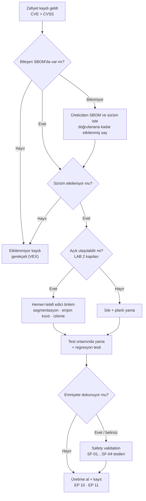

# LAB 5 · SBOM / CVE / Patch — PaketPro Sürümü (Venom 3X'e uyarlanmış)

| Ad Soyad | Grup | Tarih |
|---|---|---|
| Yunus Emeç | 1.Şube / Gece-B | 30.10.2026 |

- **Çıktı:** Vulnerability Decision → Evidence Pack **EP 09 · 10 · 11**
- **Şablon:** Safety 4.0 Bootcamp laboratuvar föyü, PaketPro 3000 Sürümü. PaketPro'nun "Component X" kaydı Venom 3X'e uyarlandı; sorular aynıdır. Föyün ön şartı olan SBOM'u görünür kılmak için bir **SBOM taslağı** eklendi.
- **Kaynaklar:** [K…] etiketleri [00-makine-kimlik-karti.md](../00-makine-kimlik-karti.md) içindeki kaynak listesine aittir. [B1–B3] bu föyün sonundaki kaynaklardır.

> **Kavram (föyden):** SBOM = yazılım malzeme listesi · CVE = açığın kayıt no'su · CVSS = ciddiyet (0–10). Bir CVE sizi etkiler mi? Üç şart: bileşen var, sürüm etkileniyor, açık ulaşılabilir.

> **Venom 3X bağlamı:** Kontrol Beckhoff (seçenekte Siemens) PLC/CNC yazılımıyla çalışıyor [K1], [K13 s.12]; el çarkı grup şirketi Elfatek'in ürünü [K13 s.10]; Tabla Koruma Elfamak'ın kendi yazılımı [K2]. Makine için kamuya açık bir SBOM yok, yazılım sürümleri bilinmiyor. Ağa açılan kapılar fabrika ağı (K-05) ve uzak servis (K-02), yerel kapı USB (K-01). Emniyet mantığının kontrol sistemiyle aynı yerde olup olmadığı belirsiz (LAB 1 Soru 3).

## Görev A0 — SBOM taslağı (EP 09)

*"SBOM olmadan bilemezsiniz" (föy destesi). Aşağıdaki liste kamuya açık bilgiden çıkarılabilen en iyi taslaktır; sürüm sütunu bu yüzden boştur.*

| # | Bileşen | Tür | Üretici | Sürüm | Güvenlik bildirimi kanalı | Kaynak |
|---|---|---|---|---|---|---|
| S-01 | PLC/CNC çalışma zamanı ve kütüphaneleri | Firmware / yazılım | Beckhoff (seçenekte Siemens) | Bilinmiyor | Beckhoff güvenlik bildirimleri ve CERT@VDE [B1], [B2]; Siemens seçeneğinde Siemens ProductCERT | [K1], [K13 s.12] |
| S-02 | Panel PC işletim sistemi | İşletim sistemi | **Varsayım:** masaüstü işletim sistemi | Bilinmiyor | İşletim sistemi üreticisinin güvenlik güncellemeleri | [K13 s.7] |
| S-03 | Servo sürücü firmware'i | Firmware | Beckhoff | Bilinmiyor | Beckhoff güvenlik bildirimleri [B1] | [K1] |
| S-04 | Emniyet modülü programı (varsa) | Emniyet konfigürasyonu | Bilinmiyor | Bilinmiyor | Bilinmiyor | **Varsayım** |
| S-05 | Elfamak uygulama programı: vakum bölge, takım boyu, yükleme mantığı | PLC programı | Elfamak | Bilinmiyor | Kamuya açık kanal bulunamadı | [K1], [K13 s.6] |
| S-06 | Tabla Koruma yazılımı | Yazılım | Elfamak | Bilinmiyor | Kamuya açık kanal bulunamadı | [K2] |
| S-07 | Kablosuz el çarkı firmware'i | Firmware | Elfatek | Bilinmiyor | Kamuya açık kanal bulunamadı | [K13 s.10] |
| S-08 | CAM / nesting yazılımı (işletme tarafı) | Yazılım | Doğrulanmadı | Bilinmiyor | CAM üreticisi | [K13 s.10], [K4] |

**Bulgu:** 8 bileşenin hiçbirinin sürümü bilinmiyor. Üçünün (S-05…S-07) kamuya açık bir güvenlik bildirimi kanalı da yok: firmanın dökümanlar sayfasında katalog, CE ve politika belgeleri yayımlanmış, ama zafiyet bildirimi yayımlanmamış [K4]. Bu, CRA'nın SBOM ve zafiyet yönetimi yükümlülükleri karşısında bir açıktır (Kavramlar Sözlüğü: CRA).

## Verilen zafiyet kaydı (Venom'a uyarlandı)

| Alan | Değer |
|---|---|
| Bileşen | **Venom 3X Component X** — kontrol ünitesindeki PLC firmware kütüphanesi (SBOM'da S-01) |
| Sürüm | 2.4 |
| CVE | CVE-XXXX-XXXX *(föyün varsayımsal kaydı)* |
| Önem | Critical (CVSS 9.8) |
| Yama | Mevcut |

> **Gerçek dünyadan bir örnek:** Kayıt varsayımsal, ama gerçek bildirimler aynı yapıda. Beckhoff'un 2021-001 numaralı bildirimi (CVE-2020-12526) TwinCAT OPC UA sunucusundaki bir hizmet aksatma açığını anlatıyor; puanı CVSS 5.3, vektörü `AV:N/AC:L/PR:N/UI:N/S:U/C:N/I:N/A:L` [B3]. Vektördeki **AV:N** "ağdan ulaşılabilir" demektir. Bildirim çözüm olarak güncellemenin yanında, ilgili TCP portuna erişimin güvenlik duvarıyla sınırlandırılabileceğini de söylüyor [B3]. Bu, Soru 5'teki telafi edici önlemin birebir örneğidir. *Venom'un bu sürümleri kullanıp kullanmadığı bilinmiyor; örnek yalnızca karar mantığını göstermek içindir.*

## Görev — karar akışı

**1. Bu CVE sizi gerçekten etkiliyor mu? (üç şartı kontrol edin)**

| Şart | Venom 3X'te durum | Nasıl doğrulanır |
|---|---|---|
| Bileşen var mı? | **Bilinmiyor** — S-01 olası, ama SBOM yok | Elfamak'tan makineye özel SBOM istenir |
| Sürüm 2.4 etkileniyor mu? | **Bilinmiyor** | Makine başında kontrol yazılımının sürüm ekranı okunur → EP 08 Software/Firmware Inventory |
| Açık ulaşılabilir mi? | **Ağ bağlantısı varsa evet.** 9,8 tipik olarak AV:N/PR:N/UI:N demektir (kesin vektör kayıttan okunur). Venom'da K-05 ve K-02 varsa kütüphaneye ağdan ulaşılabilir. LAB 4 hedef mimarisinde (C2 kapalı, C1 tek yön) ulaşılabilirlik büyük ölçüde düşer | LAB 2 envanterindeki dış bağlantılar sahada doğrulanır |

**Sonuç: "etkilenebilir"** — doğrulanana kadar etkilenmiş sayılır. Doğrulama "etkilenmiyor" çıkarsa bu da gerekçesiyle kayda geçer. Sektörde bu "etkilenmiyor, çünkü…" beyanına VEX denir; müşterinin aynı soruyu tekrar sormasını önler.

**2. Üretimi hemen durdurur musunuz? Neden / neden değil?**

**Hayır, otomatik olarak değil.** CVSS 9,8 açığın teknik ciddiyetidir; Venom'daki risk, LAB 3'ün ölçeğiyle ayrıca okunur. Kontrol ünitesi bu açıkla ele geçerse zincir şöyle ilerleyebilir:
- program ve parametre değişir → **R-03** (fırlayan parça, S3);
- emniyet mantığı aynı sistemdeyse → **R-02** (acil durdurmanın gecikmesi, S3).

Bu yüzden:
- **Hemen:** telafi edici önlemler (Soru 5). Üretim kontrollü devam eder.
- **Durdurma ölçütü:**
  - (a) açığın aktif olarak istismar edildiğine dair bir belirti olması,
  - (b) makinenin ağdan ayrılamaması **ve** emniyet mantığının kontrol ünitesiyle aynı sistemde olması.
- **Kim karar verir:** Safety 4.0 RACI'ye göre yama/güncellemede **R = OT, A = Yönetim**; Servis (Elfamak) ve Safety görüşü alınır (C).

Not: Durdurmak da bir karardır ve bedeli vardır. CNC işleme sırasında kontrolsüz bir duruş, kendi başına bir tehlikedir (LAB 1 Soru 6: güvenli durum).

**3. Yamayı doğrudan mı uygularsınız, önce test mi? Nerede test?**

**Önce test**, sırasıyla:
1. **Elfamak'ın test ortamında:** Makine üreticisi, kontrol yazılımı üreticisinin yamasını kendi uygulama programıyla (S-05) birlikte dener.
2. **Yedek kontrol ünitesinde:** aynı yazılım sürümleriyle kurulmuş bir test standında.
3. **Planlı bakım duruşunda makinede:** makine güvenli durumdayken, öncesinde tam yedek alınmışken (EP 12) ve geri dönüş adımları yazılıyken.

Test, makinenin işini bozmadığını göstermeli; bu bir **regresyon testidir**. Takım yolu doğruluğu, takım boyu ölçümü ve hafızası, Tabla Koruma eşiği (1 mm), vakum bölge seçimi ve otomatik yükleme/boşaltma döngüsü yama öncesindeki gibi çalışmalı.

**4. Bu yama bir safety validation etkiliyor mu? Nasıl anlarsınız?**

**Belirsiz, o yüzden "evet" sayılır.** Yama S-01'i değiştiriyor. Emniyet mantığı (S-04) aynı sistemde ya da aynı haberleşme hattındaysa etkilenebilir (LAB 1 Soru 3, LAB 4 R1–R4). Nasıl anlarız:

| Yöntem | Ne gösterir |
|---|---|
| (a) Üreticinin yama notu | Emniyet fonksiyonlarına etkisi olup olmadığı beyanı |
| (b) Emniyet konfigürasyonunun sağlama değeri (checksum) | Yama öncesi ve sonrası aynıysa emniyet programı değişmemiştir |
| (c) Fonksiyon testleri — her durumda | **SF-01** acil stop (panel **ve** el çarkı) ile durma, **SF-02** erişim algılama, **SF-03** el çarkı bağlantısı kopunca durma (R5), **SF-04** vakum düşünce durma |

Testlerin kaydı EP 15 Verification/Test ve EP 14 Change Management'a girer. Emniyetle ilgili değişiklikte RACI'ye göre **R = Safety**.

**5. Yama mümkün değilse compensating control (telafi edici önlem) ne olur?**

Kavramlar Sözlüğü'nün üç başlığıyla, Venom'a özgü:

| Önlem türü | Venom 3X'te | LAB bağlantısı |
|---|---|---|
| **Segmentasyon** | Makine kontrol bölgesi (Z2) fabrika ağından güvenlik duvarıyla ayrılır; yalnızca program aktarımı tek yönlü geçer | LAB 2 C1, Z2 |
| **Erişim kısıtı** | Uzak servis varsayılan olarak kapalı, açılışı makine başı onayıyla; USB yalnızca kayıtlı bellekle; kişisel hesaplar | LAB 4 ilke 1–4, C2 |
| **İzleme** | Oturum kaydı; program ve parametre değişikliği kaydı (Tabla Koruma eşiği, takım tablosu); beklenmedik ağ trafiği | LAB 4 ilke 5 |
| **Kayıt** | Riskin kabul edildiği, sahibi ve hedef tarihiyle EP 10'a yazılır; üreticiden yama takvimi istenir | LAB 3 sahiplik |

## Karar akışı (şema)

## Çıktı — Vulnerability Decision (EP 10)

| Alan | Değer |
|---|---|
| Kayıt no | VD-01 |
| Tarih / hazırlayan | 30.10.2026 · Yunus Emeç (1.Şube / Gece-B) |
| Makine | Elfamak Venom 3X, Beckhoff kontrol konfigürasyonu |
| Bileşen / sürüm | Component X (PLC firmware kütüphanesi, SBOM S-01) · 2.4 |
| CVE / CVSS | CVE-XXXX-XXXX · 9.8 Critical *(föyün varsayımsal kaydı)* |
| Üç şart | Bileşen: bilinmiyor · Sürüm: bilinmiyor · Ulaşılabilirlik: ağ bağlantısı varsa evet → **etkilenebilir** |
| Makinedeki etki zinciri | R-03 (S3); emniyet mantığı aynı sistemdeyse R-02 (S3) |
| Karar | Üretim durdurulmaz; telafi edici önlemler hemen; bileşen ve sürüm doğrulanır; yama test ortamında denenir; safety validation sonrası üretime alınır |
| Safety validation | **Gerekli** (belirsizlik nedeniyle) — SF-01…SF-04 testleri |
| RACI | Yama: R = OT, A = Yönetim, C = Tasarım, IT, Safety, Servis · Emniyet değişikliği: R = Safety |
| Hedefler *(öneri)* | Telafi edici önlemler: 24 saat · Bileşen/sürüm doğrulaması: 7 gün · Yama + validation: ilk planlı bakım duruşu |
| Kanıt → EP | EP 09 SBOM · EP 10 bu kayıt · EP 11 yama kaydı · EP 14 değişiklik · EP 15 test |

**EP durumu:** EP 09 **Taslak** (bileşenler var, sürümler yok) · EP 10 **Taslak** · EP 11 **Yok** (yama kaydı yok).

---

## Kaynaklar (erişim: Ekim 2026)

- **[B1]** Beckhoff, IPC güvenlik bildirimleri listesi (RSS ve CERT@VDE üzerinden de yayımlanıyor) — https://infosys.beckhoff.com/content/1033/ipc_security/216172783089841163.html
- **[B2]** CERT@VDE, Beckhoff bildirimleri — https://certvde.com/de/advisories/vendor/beckhoff/
- **[B3]** Beckhoff Security Advisory 2021-001 (CVE-2020-12526) — https://download.beckhoff.com/download/Document/product-security/Advisories/advisory-2021-001.pdf

---

*Bu föyün çıktısı Vulnerability Decision → Evidence Pack EP 09 · 10 · 11 başlığına oturur.*

*Bu bir eğitim çıktısıdır, resmî denetim değildir.*
