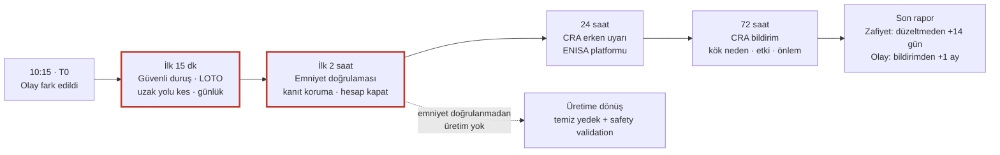

# LAB 6 · CRA Incident Simulation — PaketPro Sürümü (Venom 3X'e uyarlanmış)

| Ad Soyad | Grup | Tarih |
|---|---|---|
| Yunus Emeç | 1.Şube / Gece-B | 06.11.2026 |

- **Çıktı:** Incident Workflow → Evidence Pack **EP 13 Incident Response**
- **Şablon:** Safety 4.0 Bootcamp laboratuvar föyü, PaketPro 3000 Sürümü. Senaryo Venom 3X'e uyarlandı. PaketPro'daki 2. soru "Egzoz güvende mi?" diyor; egzoz, föy destesindeki Karabudak boya hattının emniyet fonksiyonudur. Venom'daki karşılığı SF-01…SF-04 olduğu için soru onlara çevrildi.
- **Kaynaklar:** [K…] etiketleri [00-makine-kimlik-karti.md](../00-makine-kimlik-karti.md) içindeki listeye, [C1–C4] bu föyün sonundaki CRA kaynaklarına aittir.

> **Kavram (föyden):** Bir olayda en değerli iki şey zaman ve kanıttır. CRA'nın 24s / 72s / 14 gün yükümlülükleri, iyi bir müdahale akışının doğal kilometre taşlarıdır — ezber değil.

> **Senaryo (Venom'a uyarlandı):** Saat 10:15. Venom 3X'in servis hesabına gece 03:00'te tanınmayan bir konumdan, uzak servis yolu üzerinden (K-02, **Varsayım**) girilmiş. Kontrol yazılımı ve emniyet konfigürasyonu değişmiş olabilir; acil durdurmanın tepki süresi, el çarkı bağlantı davranışı ve Tabla Koruma eşiği henüz doğrulanmadı. Makine otomatik yükleme ve boşaltmayla seri üretimde. Vardiya sorumlusu sizsiniz.
>
> **Önceki lablarla bağlantı:** Bu, LAB 3'teki **R-04**'ün kapısından (uzak servis) girip **R-02**'nin hedefine (emniyet konfigürasyonu, S3) uzanma ihtimali olan bir olay. LAB 4'ün beş ilkesi tam bunu önlemek içindi; LAB 5'in SBOM eksikliği de 24 saatlik erken uyarıda kendini gösterecek.

## Görev — zaman çizgisini doldurun

**1. 10:15 — ilk 15 dk: Kimi ararsınız? İlk üç eyleminiz?**

| Kimi | Neden | RACI ("Incident" satırı) |
|---|---|---|
| Bakım / OT sorumlusu | Makineyi güvenli durdurur, enerjisini keser ve kilitler | **R** |
| İşletmenin BT sorumlusu | Uzak erişim yolunu keser, kanıtı korur | **R** |
| Elfamak servisi | Ele geçirilen hesabın sahibi. Üretici olarak CRA bildirim yükümlüsü; 24 saatlik süre onun **haberdar olduğu andan** başlar | **C** (bildirim yükümlülüğü üreticide) |
| Yönetim | Üretime dönüş ve dış bildirim kararları | **A** |

**İlk üç eylem — önce emniyet, hemen sonra kanıt:**
1. **Emniyet.** Makine normal duruş komutuyla, kontrollü durdurulur. Ardından servo ve spindle tahrik enerjisi kesilip kilitlenir (LOTO). Acil durdurmaya güvenilmez, çünkü tepki süresi değiştirilmiş olabilir (R-02). Yükleme, boşaltma ve köprü bölgesine kimse girmez.
2. **Yalıtım.** Uzak servis bağlantısı fiziksel olarak kesilir; kablo çekilir, LAB 2'deki C2 geçişi kapanır. Kontrol PC'si **resetlenmez, yeniden başlatılmaz**. Beslemesi tahrikten ayrıysa açık bırakılır, böylece bellekteki iz kaybolmaz. Ayrı değilse emniyet önceliklidir: enerji kesilmeden önce ekran fotoğrafları çekilir ve dışa aktarılabilen kayıtlar alınır.
3. **Kayıt.** Zaman damgalı olay günlüğü başlatılır: 10:15'te ne fark edildi, kim fark etti, ekranda ne vardı, kim ne zaman aradı.

**2. İlk 2 saat: Emniyet fonksiyonları güvende mi — nasıl doğrularsınız? Hangi kanıt korunur? Hangi hesap kapatılır?**

*(Orijinal PaketPro sorusu: "Egzoz güvende mi — nasıl doğrularsınız?")*

**Emniyet doğrulanana kadar güvende sayılmaz; makine üretime alınmaz.**

| Doğrulama | Nasıl | LAB bağlantısı |
|---|---|---|
| Emniyet konfigürasyonu | Sağlama değeri (checksum), bilinen iyi değerle karşılaştırılır. Bilinen iyi değer kayıtlı değilse doğrulama yapılamaz; bu kendi başına bir bulgudur (EP 12) | LAB 5 Soru 4 |
| SF-01 acil durdurma | Panel **ve** el çarkı butonuyla durma; durma süresi önceki değerle karşılaştırılır | LAB 1 |
| SF-03 manuel modda güvenli hareket | El çarkı bağlantısı kesilince eksen durmalı; manuel hız sınırı yerinde olmalı | LAB 4 R5 |
| SF-04 vakum tutuşu | Vakum düşünce işleme durmalı | LAB 1 |
| MF-01 Tabla Koruma, takım tablosu | Eşik 1 mm mi, takım boyları değişmiş mi | LAB 3 R-03 |

**Korunacak kanıt** (önce uçucu olan, sonra kalıcı olan; her kopyanın hash'i alınır, kimin ne zaman aldığı yazılır):
- servis hesabının giriş kayıtları (03:00, kaynak adres),
- uzak erişim yazılımı, VPN ve jump server kayıtları,
- kontrol PC'sinin ve HMI'nin olay günlükleri,
- CNC program ve parametre dosyalarının o anki kopyası,
- emniyet konfigürasyonunun kopyası ve sağlama değeri,
- güvenlik duvarı ve ağ kayıtları,
- ekran fotoğrafları.

**Kapatılacak hesaplar:**
- Ele geçirilen servis hesabı **devre dışı bırakılır, silinmez**; silmek de kanıtı yok eder.
- Aynı servis parolası Elfamak tarafında başka müşterilerde de kullanılıyorsa, oradaki hesaplar da kapatılır (LAB 2 Görev B: MFA gerekçesi).
- Paylaşılan panel hesabının (K-04) parolası değiştirilir.
- Uzak erişim, olay kapanana kadar **varsayılan kapalı** moda alınır (LAB 4 ilke 4).

**3. 24 saat — CRA erken uyarı: Hangi bilgi hazır olmalı?**

**Kim, nereye, ne zaman:** Erken uyarıyı **üretici (Elfamak)** verir. Bildirim, ENISA'nın tek raporlama platformu üzerinden koordinatör CSIRT'e ve ENISA'ya aynı anda gider [C3]. Süre, üreticinin olaydan haberdar olmasından itibaren 24 saattir [C1]. Koordinatör CSIRT'ün hangi üye devletinki olacağı, AB dışında yerleşik olan Elfamak'ın AB'deki temsil yapısına bağlıdır (**doğrulanmalı**).

| Hazır olması gereken bilgi | Venom 3X'te kaynağı | Hazır mı? |
|---|---|---|
| Üreticinin olaydan haberdar olduğu an | Olay günlüğü (Soru 1, eylem 3) | Evet, eylem 3 sayesinde |
| Etkilenen ürün: model, seri no, yazılım sürümü | Makine etiketi + SBOM (EP 09) | **Kısmen:** SBOM taslağında sürümler yok (LAB 5) |
| Yasa dışı veya kötü niyetli bir eylemden şüphelenilip şüphelenilmediği (ciddi olayda zorunlu) [C2] | Tanınmayan konum, gece 03:00 → **evet, şüpheleniliyor** | Evet |
| Olası yayılım: aynı servis hesabını kullanan başka makineler | Elfamak servis kayıtları | Elfamak'a bağlı |
| İlk önlemler | Hesap kapatıldı, uzak yol kesildi, makine güvenli durumda | Evet |

**Küçük işletme notu:** Mikro ve küçük işletmelere 24 saatlik erken uyarı süresini kaçırdıkları için para cezası verilemiyor. Ama bu muafiyet ne 72 saatlik bildirimi, ne son raporu, ne de bildirim yükümlülüğünün kendisini kapsıyor [C4]. Elfamak çalışan sayısına göre (25–49) [K5] küçük işletme ölçütüne uyuyor; ciro ve bilanço bilinmediği için kesin değil (**Varsayım**). Muafiyet bir rahatlama değil: süre yine de en iyi uygulamadır.

**4. 72 saat — CRA bildirim: Kök neden, etki, önlem — kim ne yapıyor?**

72 saatlik bildirim; olayın niteliğini, ilk değerlendirmeyi ve alınan ve kullanıcılara sunulan önlemleri kapsar [C3].

| Konu | Kim | Ne yapıyor |
|---|---|---|
| **Kök neden** | Elfamak (üretici) + işletme BT (**R**) | Hipotezleri kayıtlarla sınar: paylaşılan veya zayıf servis parolası, MFA yokluğu, sürekli açık uzak yol (K-02), ele geçirilmiş servis dizüstü bilgisayarı (tedarik zinciri) |
| **Etki** | İşletme OT (**R**) + Safety (**C**) | Değişen dosya ve parametreleri, hash ve sağlama değeri karşılaştırmasıyla listeler; emniyete dokunup dokunmadığını belirler (R-02 / R-03) |
| **Önlem** | OT (**R**), Safety (emniyet değişikliğinde **R**), Yönetim (**A**) | Bilinen iyi yedekten temiz kurulum (EP 12) → safety validation (EP 15) → üretime dönüş kararı. Kalıcı önlem: LAB 4'ün beş ilkesi + R1–R5 |
| **Kullanıcılar** | Elfamak | Etkilenen müşterileri ve alabilecekleri önlemleri bilgilendirir [C3] |
| **Bildirim** | Elfamak | 72 saatlik bildirimi platform üzerinden verir |

**5. 14 gün — son rapor: Hangi loglar/kayıtlar korunmuş olmalı?**

**Önce takvim:** Föyün "14 günü" iki yoldan biridir. CRA'da iki ayrı son rapor süresi var [C2], [C3]:

| Yol | Erken uyarı | Bildirim | Son rapor |
|---|---|---|---|
| Aktif istismar edilen **zafiyet** | 24 saat | 72 saat | Düzeltme veya hafifletme önlemi yayımlandıktan sonra **14 gün** |
| **Ciddi olay** | 24 saat | 72 saat | 72 saatlik bildirimden sonra **1 ay** |

Bu senaryo bir **ciddi olay**dır. Kök neden bir ürün zafiyetiyse (örneğin uzak servis yazılımında), aynı olaydan bir de **zafiyet** yolu açılır.

**Korunmuş olması gereken kayıtlar:**

| Kayıt | Neden gerekli | EP |
|---|---|---|
| Uzak erişim, VPN ve jump server oturum kayıtları | Kim, ne zaman, nereden girdi | 06 |
| Kimlik doğrulama (MFA) kayıtları | Hesap nasıl ele geçirildi | 06 |
| Kontrol PC'si ve HMI olay günlükleri | Saldırgan makinede ne yaptı | 13 |
| Program ve parametre değişiklik geçmişi + hash'ler | Neyin değiştiğinin kanıtı | 14 |
| Emniyet konfigürasyonu sağlama değerleri (öncesi ve sonrası) | Emniyete dokunuldu mu | 03 · 15 |
| Güvenlik duvarı ve ağ kayıtları | Giriş yolu ve yayılım | 05 |
| Olay günlüğü + kanıt zinciri kaydı | Zaman çizelgesi ve kanıtın bütünlüğü | 13 |
| Safety validation ve düzeltici önlem kayıtları | Makine neden yeniden güvenli | 11 · 15 |

> **Asıl ders:** Bu kayıtlar olaydan **önce** var olmalı. LAB 4'teki "oturum kaydı" ilkesi uygulanmamışsa, son raporun en önemli bölümü yazılamaz. Kanıt, olay anında değil olaydan önce hazırlanır.

> **En sık hata (föyden):** "Resetleyip devam edelim" — o düğme, kanıtı sonsuza dek siler. Önce emniyet, hemen sonra kanıt.

## Zaman çizelgesi (şema)

## Çıktı — Incident Workflow (EP 13)

| Zaman | Kilometre taşı | Eylem | Sahip (RACI) | Kanıt / çıktı → EP |
|---|---|---|---|---|
| T0 = 10:15 | Fark etme | Olay günlüğü açılır | Vardiya sorumlusu | Olay günlüğü → 13 |
| 0–15 dk | Emniyet + yalıtım | Kontrollü duruş, LOTO; uzak yol kesilir; PC resetlenmez; Elfamak aranır | OT **R** · IT **R** | Zaman damgalı kayıtlar → 13 |
| 15 dk – 2 saat | Doğrulama + kanıt | Sağlama değeri, SF-01…SF-04 testleri; kayıtlar hash'lenerek kopyalanır; servis hesabı devre dışı | OT **R** · Safety **C** · IT **R** | Kanıt zinciri → 13; test kaydı → 15 |
| ≤ 24 saat | CRA erken uyarı | Kötü niyet şüphesi + ürün + ilk önlemler | Elfamak (üretici) · Yönetim **A** | Erken uyarı kaydı → 13 |
| ≤ 72 saat | CRA bildirim | Kök neden hipotezi, etki listesi, önlemler; kullanıcı bilgilendirme | Elfamak · OT/IT **R** | Bildirim kaydı → 13 |
| Üretime dönüş | Temiz kurulum | Bilinen iyi yedek + safety validation | OT **R** · Safety **R** · Yönetim **A** | → 11 · 12 · 15 |
| ≤ 1 ay (olay) / ≤ 14 gün (zafiyet) | Son rapor | Ayrıntılı tanım, olası tehdit türü, uygulanan ve süren önlemler | Elfamak · Yönetim **A** | Son rapor → 13 |

**EP 13 durumu: Taslak.** Akış ve roller tanımlandı; tatbikatı yapılmadı.

---

## Kaynaklar (erişim: Kasım 2026)

- **[C1]** The National Law Review, "Cyber Resilience Act: 11 September 2026 – Key Starting Point for Reporting Obligations" — https://natlawreview.com/article/cyber-resilience-act-11-september-2026-key-starting-point-reporting-obligations
- **[C2]** Raspberry Pi, "The EU Cyber Resilience Act: mandatory reporting requirements" — https://www.raspberrypi.com/news/the-eu-cyber-resilience-act-mandatory-reporting-requirements/
- **[C3]** BD Emerson, "Cyber Resilience Act reporting" — https://www.bdemerson.com/article/cyber-resilience-act-reporting
- **[C4]** Citadelo, "CRA vulnerability reporting" — https://citadelo.com/en/blog/cra-vulnerability-reporting
- Ders materyali: Safety 4.0 Bootcamp sunumu (RACI tablosu), Kavramlar Sözlüğü (Olay & Mevzuat)

---

*Bu föyün çıktısı Incident Workflow → Evidence Pack EP 13 Incident Response başlığına oturur.*

*Bu bir eğitim çıktısıdır, resmî denetim değildir; CRA'ya ilişkin bilgiler hukuki görüş değildir.*
