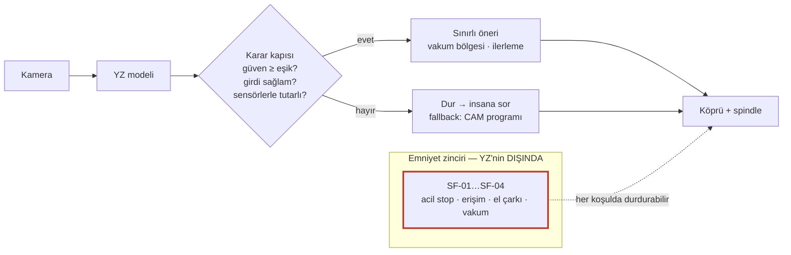

# LAB 7 · AI Safety Challenge — PaketPro Sürümü (Venom 3X'e uyarlanmış)

| Ad Soyad | Grup | Tarih |
|---|---|---|
| Yunus Emeç | 1.Şube / Gece-B | 13.11.2026 |

- **Çıktı:** AI Fail-Safe Decision → Evidence Pack **EP 03 + EP 15**
- **Şablon:** Safety 4.0 Bootcamp laboratuvar föyü, PaketPro 3000 Sürümü. PaketPro'nun "YZ'li görsel kontrol eklenmesi planlanıyor" senaryosu Venom 3X'e uyarlandı; sorular ve karar tablosu aynıdır.
- **Kaynaklar:** [K…] etiketleri [00-makine-kimlik-karti.md](../00-makine-kimlik-karti.md) içindeki listeye, [Y1–Y3] bu föyün sonundaki kaynaklara aittir.

> **Kavram (föyden):** Prediction ≠ Safety: Yapay zekâ bir karar üretir; güvenliği garanti eden mimari YZ'nin dışında tanımlanmalıdır.
>
> **Araçlar:** fail-safe · human override · monitoring · confidence threshold · fallback.

> **Senaryo (Venom'a uyarlandı):** Venom 3X'e YZ'li görsel plaka ve parça kontrolü eklenmesi planlanıyor — proje aşaması değerlendirmesi yapıyorsunuz.
>
> **Durum tespiti:** Kamuya açık bilgiye göre Venom 3X'te bugün bir YZ bileşeni **yok** [K1], [K13]. Bu föy, olası bir eklentinin **tasarımdan önce** değerlendirilmesidir; tüm YZ ayrıntıları **Varsayım**'dır. Gerçekçi bir eklenti: grup içinde endüstriyel elektronik ve yazılım şirketleri var [K13 s.2] ve makine zaten sensörlü konveyör ve otomatik takım boyu ölçümü gibi algılama işlevleri kullanıyor [K13 s.6, s.9].

**Akış (PaketPro → Venom):** Kamera → YZ modeli → OK / RED → ~~Ret mekanizması → Hat hızı~~ **Vakum bölge seçimi ve ilerleme önerisi → Köprü + spindle**

| Aşama | Venom'daki karşılığı (varsayımsal eklenti) |
|---|---|
| Kamera | Köprü üzerinde, tablaya ve boşaltma konveyörüne bakan kamera |
| YZ modeli | (a) Otomatik yüklemeden sonra plaka doğru yerleşti mi? (b) Kesilen parçada kusur var mı? |
| OK / RED | (a) İşlemeye başla / başlama · (b) Parçayı geçir / ayır |
| Parametre | YZ, tespit ettiği plaka boyutuna göre vakum bölgelerini ve ilerleme hızını **önerir** |
| Fiziksel sonuç | Yanlış vakum bölgesi → zayıf tutuş → parça fırlaması (**LAB 1 SF-04, LAB 3 R-03, S3**) |

Karabudak boya hattındaki gibi, YZ çıktısı bir fiziksel parametreyi beslediği anda hata emniyet sorusuna dönüşür. Altın kural burada geçerli: zincir fiziksel sonuçla bitiyor.

## Görev — üç başarısızlıkta güvenli davranış

**1. Model yanlış sınıflandırdı: Kusurlu parçaya (ya da kaymış plakaya) OK verdi. Sistem ne yapmalı? İkinci kontrol / insan onayı var mı?**

**İlke: YZ'nin OK'i bir öneridir, izin değildir.** İşlemenin başlaması YZ'den bağımsız üç kontrolün hepsine bağlanır:

| İkinci kontrol | Neyi doğrular | Kaynak / bağlantı |
|---|---|---|
| Referanslama dayamalarının sensörü | Plaka fiziksel olarak dayamaya oturdu mu | Bariyerli ve pistonlu referanslama [K13 s.10] |
| Vakum basıncı eşiği | Tutuş yeterli mi; eşik aşılmadan işleme başlamaz | SF-04 (LAB 1) |
| Tutarlılık kontrolü | YZ'nin ölçtüğü plaka boyutu CAM programındakiyle uyuşuyor mu | CAM akışı [K9] |

- **İnsan onayı (human override):** Her yeni programın ilk plakasında ve her vardiya başında operatör onay verir. Operatör YZ kararını her zaman geçersiz kılabilir; bu da kayda geçer.
- **Kusurlu parçaya OK** (b) bir kalite hatasıdır (S1). Kayıtlardan izlenir, modelin yeniden eğitiminde kullanılır.
- **Kaymış plakaya OK** (a) ise ikinci kontrollerin yakalaması gereken emniyet ilgili bir hatadır (S3).

**2. Girdi manipüle edildi: Kamera verisi bozuk/sahte. Nasıl fark edilir? Şüpheli girdide ne yapılır?**

| Tehdit | Nasıl fark edilir |
|---|---|
| Lensin ahşap tozuyla kirlenmesi (bu makinede en olası durum) | Netlik ölçümü (örneğin Laplacian varyansı) ve kontrast eşiği; zamanla düşüş eğilimi |
| Donmuş ya da tekrar oynatılan görüntü | Kare sayacı ve zaman damgası sürekliliği; ardışık karelerin aynı olması |
| Ağ üzerinden sahte görüntü (K-05) | Kamera ile kontrol ünitesi arasında Z2 içinde kalan, kimliği doğrulanmış bağlantı (LAB 2) |
| Fiziksel sahneyle tutarsızlık | Görüntü "plaka var" derken dayama sensörü ya da vakum "yok" diyor |

**Şüpheli girdide:** karar **RED** sayılır (güvenli varsayım), otomatik çevrim bir sonraki plakada durur ve operatör uyarılır. Makine YZ'siz güvenli moda geçer: vakum bölgeleri YZ önerisine göre değil, **CAM programına göre** seçilir. Olay, kare hash'leriyle birlikte kaydedilir (LAB 6 kanıt mantığı).

**3. Confidence düştü: Model "emin değilim" diyor. Eşik ne olmalı? Altında: dur / insana sor / fallback?**
- **Eşik bir sayı tahmini değil, bir doğrulama sonucudur.** Gölge modda (YZ karar vermeden yalnızca önerir, operatör kararıyla karşılaştırılır) toplanan verilerden, yanlış OK oranını hedefin altında tutan eşik seçilir. Sınıflandırma diliyle: plaka yerleşimi kararında yanlış OK pahalıdır, eşik **duyarlılık** (recall) lehine yüksek tutulur. Parça kusuru kararında ise daha düşük bir eşik kabul edilebilir.
- **Altında sıra:** **dur** (bu plakada işleme başlamaz) → **insana sor** (operatör onayı) → onay yoksa **fallback** (YZ'siz güvenli mod, CAM programındaki bölge seçimi).
- **İzleme:** Güven skorunun haftalık ortalaması ve "emin değilim" oranı izlenir. Ani düşüş lens kirliliğine ya da ürün değişimine (yeni malzeme) işaret eder. Kalıcı düşüşte model yeniden doğrulanmadan otomatik moda dönülmez.

## Mimari kurallar (YZ'nin dışında tanımlanan güvenlik)

- **R-AI-1:** YZ, emniyet zincirinin (SF-01…SF-04) parçası değildir. Emniyet fonksiyonları YZ'den bağımsız çalışır ve YZ hiçbir emniyet parametresine yazamaz: emniyet konfigürasyonu, manuel hız sınırı, Tabla Koruma eşiği (LAB 4 R1–R3).
- **R-AI-2:** YZ'nin parametre önerileri sınırlıdır. İzinli aralık dışındaki öneri reddedilir ve kaydedilir.
- **R-AI-3:** Her karar kayda geçer: kare hash'i, model sürümü, güven skoru, karar, insan onayı. Bu kayıt izlemenin ve olay incelemesinin (LAB 6) temelidir.
- **R-AI-4:** Model de bir yazılım bileşenidir. Sürümüyle SBOM'a girer (LAB 5'e **S-09** olarak eklenir) ve her güncellemesi değişiklik yönetiminden geçer (EP 14).

## Mevzuat notu — YZ'yi emniyet fonksiyonu yaparsanız

Makine Tüzüğü 2023/1230'un Ek I Bölüm A'sındaki 5 ve 6 numaralı kategoriler şunlardır: makine öğrenmesiyle kendi kendine gelişen davranış gösterip **emniyet fonksiyonu sağlayan** güvenlik bileşenleri ve gömülü sistemler [Y2]. Bu kategorideki ürünlerde üretici kendi beyanıyla uygunluk değerlendirmesi yapamaz; **onaylanmış kuruluş** (Notified Body) şarttır [Y1], [Y3].

Bu föydeki tasarımda YZ emniyet fonksiyonu **değildir** (R-AI-1); dolayısıyla bu yük doğmaz. Sahada öğrenmeyen, dondurulmuş bir modelin bu kategoriye girip girmediği ayrı bir yorum konusudur. YZ'yi emniyet zincirinin dışında tutmak bu tartışmayı baştan kaldırır. Yönetim sistemi tarafında çerçeve **ISO/IEC 42001**'dir (ders materyali).

## Karar tablosu — AI Fail-Safe Decision

| Başarısızlık | Tanımladığınız güvenli davranış | Kavram |
|---|---|---|
| Model yanlış sınıflandırdı | OK bir öneridir: dayama sensörü + vakum basıncı (SF-04) + CAM boyut tutarlılığı sağlanmadan işleme başlamaz; yeni programda ve vardiya başında insan onayı; kusur hataları kayıttan yeniden eğitime | **fail-safe · human override** |
| Girdi manipüle edildi | Netlik, kare sürekliliği, kimlikli bağlantı ve sensör tutarlılığıyla tespit; şüpheli girdi = RED; YZ'siz moda (CAM programı) geçiş; kare hash'leriyle kayıt | **monitoring · fallback** |
| Confidence düştü | Eşik gölge mod verisiyle belirlenir (yanlış OK hedefin altında); altında dur → insana sor → YZ'siz mod; güven eğilimi haftalık izlenir | **confidence threshold · human override · fallback · monitoring** |

**EP 03 + EP 15 durumu: Taslak.** Güvenli davranışlar ve mimari kurallar tanımlandı. YZ henüz yok; doğrulama (EP 15) gölge mod pilotuyla yapılacak.

---

## Kaynaklar (erişim: Kasım 2026)

- **[Y1]** UL Solutions, "Navigating the New EU Machinery Regulation (EU) 2023/1230" — https://www.ul.com/resources/navigating-new-eu-machinery-regulation-eu-20231230
- **[Y2]** Parltrack, Regulation 2023/1230 dossier, 2021/0105(COD) — https://parltrack.org/dossier/2021/0105(COD)
- **[Y3]** Law Society Gazette, "The EU's Machinery Directive is being updated" — https://www.lawsociety.ie/gazette/in-depth/2026/may/the-eus-machinery-directive-is-being-updated/
- Ders materyali: Safety 4.0 Bootcamp sunumu (LAB 7 · Karabudak Kbotic), Kavramlar Sözlüğü (YZ Güvenliği)

---

*Bu föyün çıktısı AI Fail-Safe Decision → Evidence Pack EP 03 + EP 15 başlığına oturur.*

*Bu bir eğitim çıktısıdır, resmî denetim değildir; mevzuata ilişkin bilgiler hukuki görüş değildir.*
