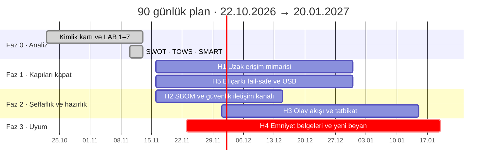

# SWOT · TOWS · SMART — Elfamak Venom 3X

| Ad Soyad | Grup | Tarih |
|---|---|---|
| Yunus Emeç | 1.Şube / Gece-B | 13.11.2026 |

- **Konu:** Elfamak Makina Teknolojileri ve Venom 3X CNC işleme merkezinin Safety 4.0 açısından SWOT analizi ve SMART iyileştirme önerileri.
- **Dayanak:** Bu belgedeki her madde, [00-makine-kimlik-karti.md](00-makine-kimlik-karti.md) içindeki kaynaklara ve LAB 1–7 föylerinin bulgularına bağlıdır. Kod ve bağlantılar maddelerin yanında verilmiştir.
- **Not:** Bu bir eğitim çıktısıdır; firmaya yönelik öneri niteliğindedir, resmî denetim değildir. Uygulama kararı firmanındır.

---

## 1. Yöntem: neden en sonda, nasıl toplandı?

**Sıra.** Stratejik planlamada SWOT, bir durum analizinin üzerine kurulur; hedefler (SMART) ise SWOT'tan sonra konur [L4]. Bu projede durum analizi yedi lab föyüdür. Bu yüzden SWOT en sona bırakıldı ve şu zincir izlendi:

> **Durum analizi (LAB 1–7) → SWOT → TOWS stratejileri → SMART hedefler → 90 günlük plan**

TOWS matrisi, SWOT'u somut strateji seçeneklerine çeviren bir araçtır (Weihrich, 1982) [L1]. SMART'ın özgün tanımı (Doran, 1981) **S**pecific, **M**easurable, **A**ssignable, **R**ealistic, **T**ime-related harflerinden oluşur [L2]. Bu belgede "Assignable" (atanabilir) harfi, Risk Register'daki RACI "A" sahibiyle doldurulur.

**Haftalık toplama.** SWOT maddeleri bir oturumda beyin fırtınasıyla yazılmadı. Proje boyunca her lab bittiğinde, o labın kanıtlı bulguları Trello'daki **SWOT havuzu** listelerine eklendi:

| Hafta (teslim) | Kaynak | Eklenen aday (S · W · O · T) | Havuz toplamı |
|---|---|---|---|
| 22–24 Ekim | Kimlik kartı + LAB 1–4 | 3 · 4 · 3 · 2 | 12 |
| 30 Ekim | LAB 5 · SBOM / CVE / Patch | 1 · 2 · 0 · 1 | 16 |
| 6 Kasım | LAB 6 · CRA Incident | 0 · 2 · 0 · 1 | 19 |
| 13 Kasım | LAB 7 · AI Safety | 1 · 0 · 1 · 1 | **22** |

**Seçim ölçütleri.** SWOT'un en çok atıf alan eleştirisi (Hill ve Westbrook, 1997) uygulamalarda uzun listeler, genel ifadeler, önceliklendirme eksikliği, doğrulanmamış maddeler ve çıktıların sonraki aşamalarda kullanılmaması bulmuştur [L3]. Bu yüzden 22 aday şu kurallarla süzüldü:
1. **Kanıt:** Her madde bir kaynağa ([K…]) ya da lab bulgusuna bağlı; bağlanamayan aday elendi.
2. **Birleştirme:** Aynı kök nedene işaret eden adaylar tek maddede birleştirildi (ör. "SBOM yok" ve "bildirim kanalı yok" → W3).
3. **Sınır:** Kutu başına en fazla dört madde, önem sırasına göre.
4. **Kullanım:** Her madde en az bir TOWS stratejisine, her strateji en az bir SMART hedefine bağlıdır. Böylece hiçbir madde havada kalmaz.

**Sonuç:** 22 aday → **16 madde** (4 · 4 · 4 · 4) → **6 strateji** → **6 SMART hedef**.

## 2. Firma seçiminin gerekçesi

- **AİMSAD üyesi:** Ders projesinin kapsadığı dernek [K8].
- **Küçük ve orta ölçekli:** 25–49 çalışan [K5]. Kamuya açık ayrı bir BT veya siber güvenlik birimi görünmüyor (**Varsayım**); hocanın "bilgi işlem departmanı olmayan firma" ölçütüne uyuyor.
- **AB pazarı:** CE beyanı ve Avrupa ağırlıklı ihracat [K3], [K13 s.14] → Makine Tüzüğü 2023/1230 ve CRA doğrudan ilgilendiriyor.
- **Dijital açıdan zengin makine:** PC tabanlı Beckhoff kontrol, kablosuz el çarkı, otomatik yükleme ve boşaltma [K1], [K13]. Safety 4.0'ın emniyet ve güvenlik kesişimi için gerçek bir örnek.
- **Analiz edilebilir:** 14 sayfalık katalog ve AT beyanı kamuya açık.

## 3. SWOT

| | **Yararlı** | **Zararlı** |
|---|---|---|
| **İç** | **🟢 S · Güçlü yönler** **S1** Kontrol ve sürücüler bilinen markadan (Beckhoff; seçenekte Siemens) ve üretici düzenli güvenlik bildirimi yayımlıyor → bileşenler izlenebilir, SBOM'a hazır zemin · *kimlik §4, LAB 5* **S2** Görünür emniyet donanımı: panelde ve kablosuz el çarkında acil durdurma butonu · *katalog s.7, s.10; LAB 1* **S3** Grup içi elektronik ve yazılım yetkinliği: el çarkı Elfatek'ten; grupta endüstriyel elektronik ve savunma yazılımı şirketleri var · *kimlik §1, §3* **S4** Algılama altyapısı hazır: sensörlü konveyör, otomatik takım boyu ölçümü, bariyerli referanslama → deterministik çapraz kontroller için zemin · *katalog s.6, 9, 10; LAB 7* | **🔴 W · Zayıf yönler** **W1** Emniyet mimarisi kamuya açık kanıtla gösterilmiyor: erişim algılama, emniyet devresinin yapısı, PLr/SIL yok; AT beyanı 2017 tarihli, ISO 13849 / IEC 62061 atfı yok, adresi eski · *LAB 1; kimlik §5–6* **W2** Dijital kapılar doğrudan kontrol ünitesine açılıyor: USB/program yolu ve acil stop sinyali kablosuz olan el çarkı · *LAB 2–4; R-01, R-03, R5* **W3** Yazılım şeffaflığı yok: SBOM yok, 8 bileşenin sürümü bilinmiyor; Elfamak ve Elfatek bileşenleri için güvenlik bildirim kanalı yok · *LAB 5* **W4** Olay hazırlığı yok: olay bildirim kanalı ve prosedürü yok; emniyet konfigürasyonunun bilinen iyi değeri ve yedeği için kanıt yok · *LAB 6* |
| **Dış** | **🔵 O · Fırsatlar** **O1** Makine Tüzüğü 2023/1230 (20.01.2027): erken uyum, satış ve ihracatta avantaj · *kimlik §6* **O2** CRA (bildirimler 11.09.2026'dan beri): SBOM, güvenlik bildirim kanalı ve olay akışı kuran üretici AB müşterilerine güven verir · *kimlik §6; LAB 5–6* **O3** AİMSAD üyeliği ve Avrupa ağırlıklı ihracat ağı · *kimlik §1* **O4** YZ'li görsel kalite kontrol, emniyetin dışında tasarlanırsa katma değerli bir ürün özelliği olur · *LAB 7* | **🟠 T · Tehditler** **T1** 20.01.2027'den sonra 2006/42/AT'ye dayanan beyanla AB'ye arz edilememe · *kimlik §6* **T2** CRA'nın SBOM, zafiyet yönetimi ve bildirim yükümlülükleri; karşılanmazsa yaptırım ve pazar kaybı · *LAB 5–6* **T3** Uzak servis yolundan fidye; ortak bir servis kimliği ele geçirilirse birden çok müşterinin makinesi etkilenir (**Varsayım**) · *LAB 3 R-04; LAB 6* **T4** YZ emniyet fonksiyonu yapılırsa Makine Tüzüğü Ek I Bölüm A gereği onaylanmış kuruluş zorunlu: süre ve maliyet · *LAB 7* |

**Birleştirilen adaylar:** S1 ← 2 aday · W1 ← 2 · W2 ← 2 · W3 ← 2 · W4 ← 2 · T3 ← 2. **Elenen aday:** "Tabla Koruma yazılımı" güçlü yön adayı; emniyet fonksiyonu olmadığı için (LAB 1) güçlü yön sayılmadı, MF-01 olarak riskte izlendi.

## 4. TOWS — SWOT'tan stratejiye

| | **S** (S1–S4) | **W** (W1–W4) |
|---|---|---|
| **O** (O1–O4) | **SO-1 · Uyumu satış argümanına çevir** (S1, S3 × O1, O2): Bilinen bileşen tabanı ve grup içi yazılım yetkinliğiyle SBOM ve güvenlik bildirim kanalı kur; Makine Tüzüğü ve CRA uyumunu ihracatta öne çıkar.  **SO-2 · YZ'yi doğru mimariyle ekle** (S3, S4 × O4): YZ'li kalite kontrolü "Prediction ≠ Safety" mimarisinde, mevcut sensörlerle çapraz kontrol ederek ve önce gölge modda pilotla. | **WO-1 · CRA'yı fırsata çevir** (W3, W4 × O2): Makine düzeyinde SBOM (EP 09) ve olay müdahale akışını (EP 13) kur, bir tatbikatla doğrula. |
| **T** (T1–T4) | **ST-1 · Var olanı belgele** (S2 × T1): Mevcut emniyet donanımını SF-01…SF-04 olarak PLr hedefleriyle belgele ve 2023/1230'a göre uygunluk beyanını yenile. | **WT-1 · Kapıları kapat** (W2 × T3): Uzak servisi jump server + MFA + kişisel hesap + kayıt + varsayılan kapalı modeline taşı; USB'yi tek yönlü ve kayıtlı yap; el çarkının fail-safe davranışını doğrula; ortak servis kimliğini kaldır.  **WT-2 · Emniyeti bağımsız kanıtla** (W1 × T1, T4): Emniyet mantığının kontrol sisteminden ve YZ'den bağımsızlığını (LAB 4 R1–R4, LAB 7 R-AI-1) tasarım kuralı olarak belgeleyip doğrula. |

## 5. SMART hedefler

| # | Strateji | **S** · Ne yapılacak | **M** · Ölçü | **A** · Sahip (RACI "A") | **R** · Neden gerçekçi | **T** · Tarih |
|---|---|---|---|---|---|---|
| **H1** | WT-1 | Sahadaki tüm Venom 3X'lerde uzak servisi jump server + VPN + MFA + kişisel hesap + oturum kaydı + varsayılan kapalı modeline taşımak; ortak servis parolasını kaldırmak | Ortak parola kullanan makine = 0; MFA'lı kişisel hesap oranı %100; kayıtlı uzak oturum oranı %100 | Elfamak servis sorumlusu (R: BT desteği) | Ticari çözümler hazır; değişiklik makineye değil erişim yoluna dokunuyor (LAB 4) | 31.12.2026 |
| **H2** | WO-1 · SO-1 | Makine düzeyinde SBOM (S-01…S-09) ve web sitesinde güvenlik iletişim sayfası yayımlamak; Beckhoff/Siemens bildirimlerine abone olmak | SBOM bileşenlerinin %100'ü sürümüyle kayıtlı; iletişim sayfası yayında; abonelik aktif | Ar-Ge / yazılım sorumlusu | 9 bileşen; bilgiler üreticilerden ve makineden okunabilir (LAB 5) | 15.12.2026 |
| **H3** | WO-1 | EP 13 akışını prosedüre çevirip bir masa başı tatbikat yapmak; her makine için emniyet konfigürasyonunun bilinen iyi değerini ve yedeğini oluşturmak | 1 tatbikat raporu (24 saatlik erken uyarı taslağının hazırlanma süresi ölçülmüş); bilinen iyi değeri ve yedeği olan makine oranı %100 | Yönetim (R: OT ve IT) | Akış LAB 6'da hazır; tatbikat bir günlük çalışma | 15.01.2027 |
| **H4** | ST-1 · WT-2 | SF-01…SF-04 için PLr hedeflerini ve emniyet mantığının bağımsızlığını belgelemek; AT beyanını 2023/1230, ISO 13849 atfı ve güncel adresle yenilemek | 4 emniyet fonksiyonu için PLr ve doğrulama kaydı; yeni uygunluk beyanı yayımlanmış | Elektrik-otomasyon sorumlusu (R: Safety) | Ağırlıklı olarak belgeleme; tasarım değişikliği gerekirse ayrı kapsam açılır | **20.01.2027** |
| **H5** | WT-1 | El çarkının acil stop sinyalinin bağlantı kaybında makineyi durdurduğunu test etmek (R5); USB program aktarımını kayıtlı belleğe ve tek yöne kısıtlamak | Bağlantı kesme testinde 10/10 durdurma ve durma süresi kaydı; USB kısıtı uygulanan makine oranı %100 | Ar-Ge (R: Elfatek) | El çarkı grup içinden; test makine başında yapılır | 31.12.2026 |
| **H6** | SO-2 | YZ'li plaka/parça kontrolünü R-AI-1…4 kurallarıyla bir pilot makinede **gölge modda** çalıştırmak | ≥ 5.000 karşılaştırma *(öneri)*; plaka yerleşiminde yanlış OK oranı, pilot öncesi belirlenen hedefin altında; YZ'nin emniyet zincirine bağlantısı = 0 | Ar-Ge | Grup içi yetkinlik ve mevcut sensörler (S3, S4) | 01.02 → 30.04.2027 *(sonraki faz)* |

Her hedefin "M" sütunu ölçülebilir, evet/hayır ya da yüzde olarak kontrol edilebilir. Hedef değerler firmaya yönelik **öneridir**; firma kendi kapasitesine göre ayarlar.

## 6. 90 günlük plan

Analizin başladığı 22.10.2026'dan 90 gün sonrası, Makine Tüzüğü'nün uygulanmaya başladığı **20.01.2027**'ye denk gelir. Plan bu pencereye oturtuldu; H6 sonraki fazdadır.

**İzlenebilirlik:** Kanıt (K / LAB) → SWOT maddesi → TOWS stratejisi → SMART hedef → plan çubuğu. Örnek: *LAB 6'da bulunan* "bilinen iyi değer yok" → **W4** → **WO-1** → **H3** → Faz 2.

---

## Kaynaklar

**Proje kaynakları:** [00-makine-kimlik-karti.md](00-makine-kimlik-karti.md) [K1–K13]; LAB 5 [B1–B3]; LAB 6 [C1–C4]; LAB 7 [Y1–Y3].

**Yöntem kaynakları (erişim: Kasım 2026):**
- **[L1]** TOWS matrisi, Weihrich (1982) — Mind Tools, "The TOWS Matrix" — https://www.mindtools.com/auqstul/the-tows-matrix
- **[L2]** SMART ölçütleri, Doran (1981) — Wikipedia, "SMART criteria" — https://en.wikipedia.org/wiki/SMART_criteria
- **[L3]** Hill, T. ve Westbrook, R. (1997), "SWOT analysis: it's time for a product recall" — London Business School — https://www.london.edu/faculty-and-research/academic-research/s/swot-analysis-time-for-a-product-recall
- **[L4]** Durum analizi, SWOT ve hedef belirleme sırası — *Principles of Marketing*, "Components of the Strategic Planning Process" — https://saylordotorg.github.io/text_principles-of-marketing-v2.0/s05-02-components-of-the-strategic-pl.html

---

*Bu bir eğitim çıktısıdır; resmî denetim, uygunluk değerlendirmesi veya hukuki görüş değildir.*
